# KM1 部品カタログ / Component catalog

各部品の説明は部品フォルダの `README.md`、動く見本は `preview.html`（`gen/render_previews.py` で単独のページにできる）。下の画像は `gen/shoot_previews.js` で撮ったライトテーマの見本。PDF 版は `dist/KM1_部品カタログ.pdf`。
*Each folder has a README and a live `preview.html`; images below are light-theme screenshots. PDF: `dist/KM1_部品カタログ.pdf`.*

### [Accordion](Accordion/)

見出しを押して、中身を開いたり閉じたりする一覧。よくある質問、設定のまとまり、長い説明の折りたたみに使う。

### [Alert](Alert/)

状態をユーザーに知らせるバナー。色に加えて、アイコンと「情報」「成功」「注意」「エラー」の文言を必ず併記する。

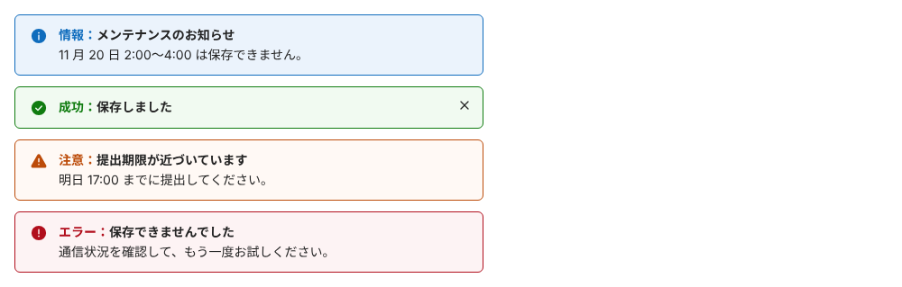

### [AppIcon](AppIcon/)

KM1 のアプリアイコンとファビコン（KM1-ICO-001 §6）。紺（`brand`）の正方形に白の「KM1」と表紙のしるし。`icons/km1_appicon.py` が 

### [Avatar](Avatar/)

人や場所を、写真か頭文字で小さく示す丸。

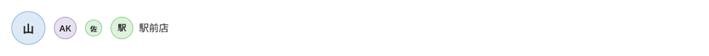

### [Badge](Badge/)

状態や件数を示す小さなラベル。丸型（`radius-circular`）。

### [BottomSheet](BottomSheet/)

狭い画面で、今の画面を保ったまま、補助の情報や選択肢を下から出す。モーダル（`modal`、既定）と持続型（`persistent`）がある。M1 の Bottom sheets 

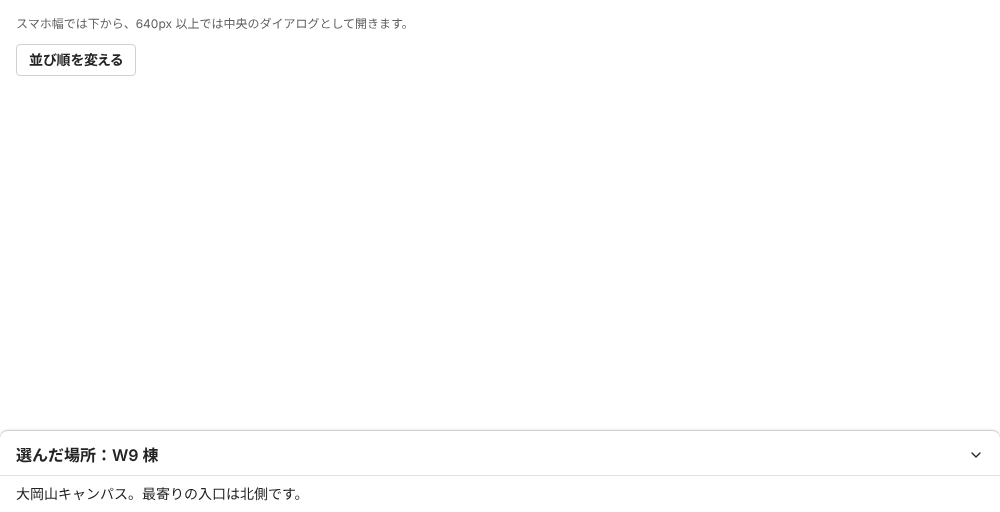

### [Breadcrumb](Breadcrumb/)

今いる画面が、全体のどこにあるかを示す道しるべ。3 階層以上ある画面で使う。

### [Button](Button/)

操作を実行するボタン。1 画面にプライマリ（`appearance="primary"`）は 1 つだけ。

### [Calendar](Calendar/)

月の表から日付を 1 つ選ぶ。予定のある日に印を付けられる。

### [Card](Card/)

関連する情報をまとめる面。`surface` 上に `shadow-2`、`radius-lg`、内側は `container-card-padding-regular`（= `s

### [CategoryPattern](CategoryPattern/)

分類を**色 × 模様**で区別するための部品。`cat-*` の 18 色に 8 つの模様（塗り・横線・縦線・斜線・格子・斜め格子・点・市松）を組み合わせ、144 通りにする。色

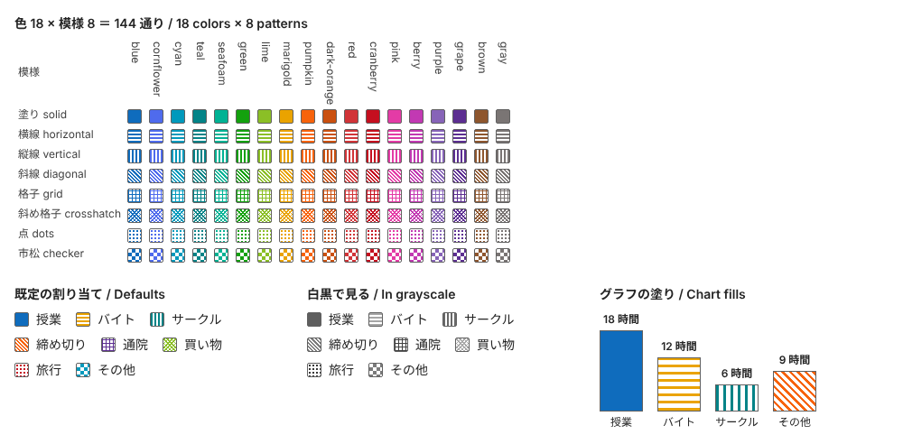

### [Checkbox](Checkbox/)

複数選択や同意のためのチェックボックス。ラベルは必ず付け、ラベルをクリックしても切り替わる。

### [Chip](Chip/)

押して切り替える小さな絞り込みボタン。一覧のフィルターや、複数選べる分類に使う。

### [Combobox](Combobox/)

入力して候補を絞り込み、1 つを選ぶ欄。選択肢が多い（6 件以上）ときに使う。

### [CompareBottomSheet](CompareBottomSheet/)

M1（初代 Material Design）の原型を寸法から再描画したもの（左）と、KM1 に合わせた案（右）の比較。左は公式の画像ではなく、出典の寸法をもとに KM1 が描いた参

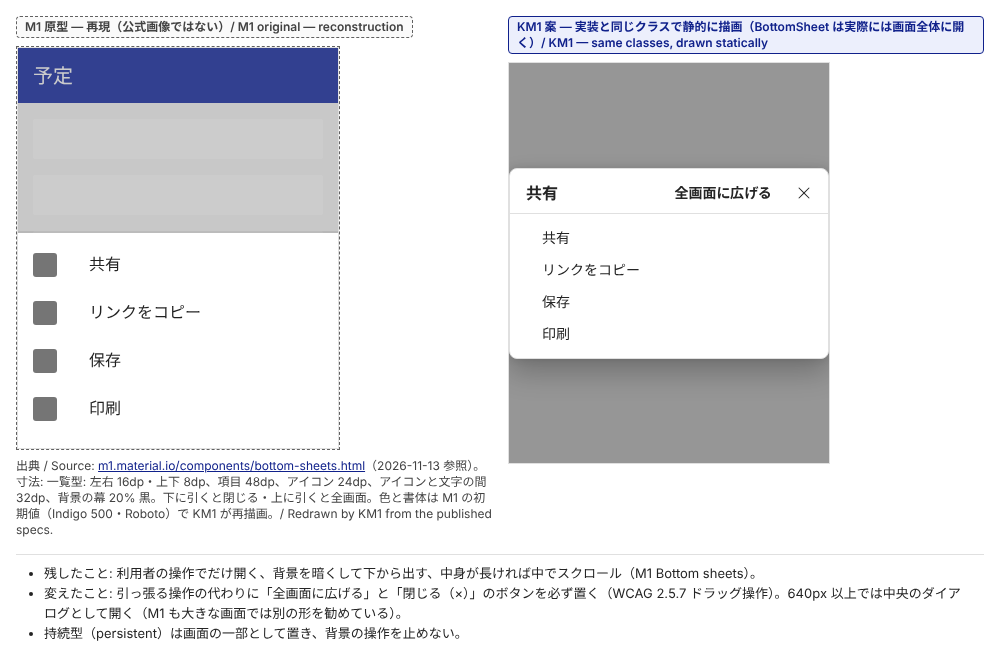

### [CompareExpansion](CompareExpansion/)

M1（初代 Material Design）の原型を寸法から再描画したもの（左）と、KM1 に合わせた案（右）の比較。左は公式の画像ではなく、出典の寸法をもとに KM1 が描いた参

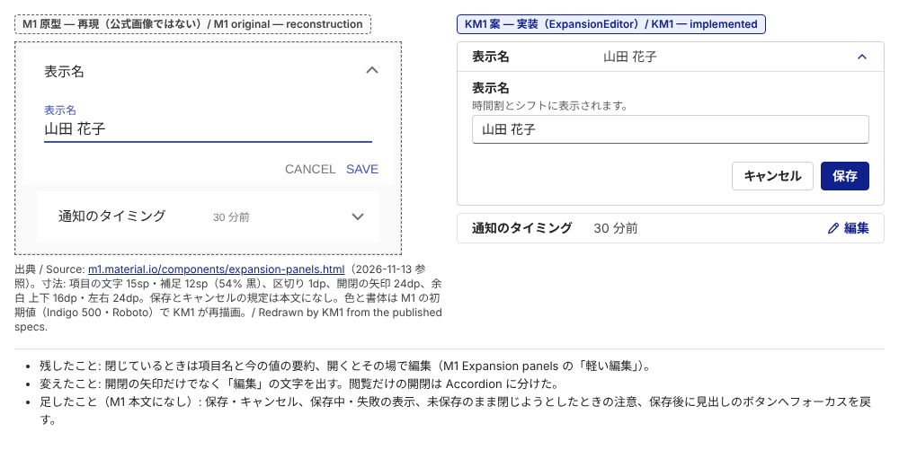

### [CompareFAB](CompareFAB/)

M1（初代 Material Design）の原型を寸法から再描画したもの（左）と、KM1 に合わせた案（右）の比較。左は公式の画像ではなく、出典の寸法をもとに KM1 が描いた参

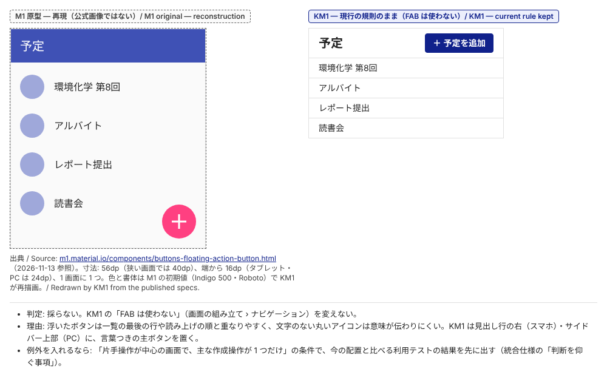

### [CompareGrid](CompareGrid/)

M1（初代 Material Design）の原型を寸法から再描画したもの（左）と、KM1 に合わせた案（右）の比較。左は公式の画像ではなく、出典の寸法をもとに KM1 が描いた参

### [CompareList](CompareList/)

M1（初代 Material Design）の原型を寸法から再描画したもの（左）と、KM1 に合わせた案（右）の比較。左は公式の画像ではなく、出典の寸法をもとに KM1 が描いた参

### [CompareSelection](CompareSelection/)

M1（初代 Material Design）の原型を寸法から再描画したもの（左）と、KM1 に合わせた案（右）の比較。左は公式の画像ではなく、出典の寸法をもとに KM1 が描いた参

### [CompareStepper](CompareStepper/)

M1（初代 Material Design）の原型を寸法から再描画したもの（左）と、KM1 に合わせた案（右）の比較。左は公式の画像ではなく、出典の寸法をもとに KM1 が描いた参

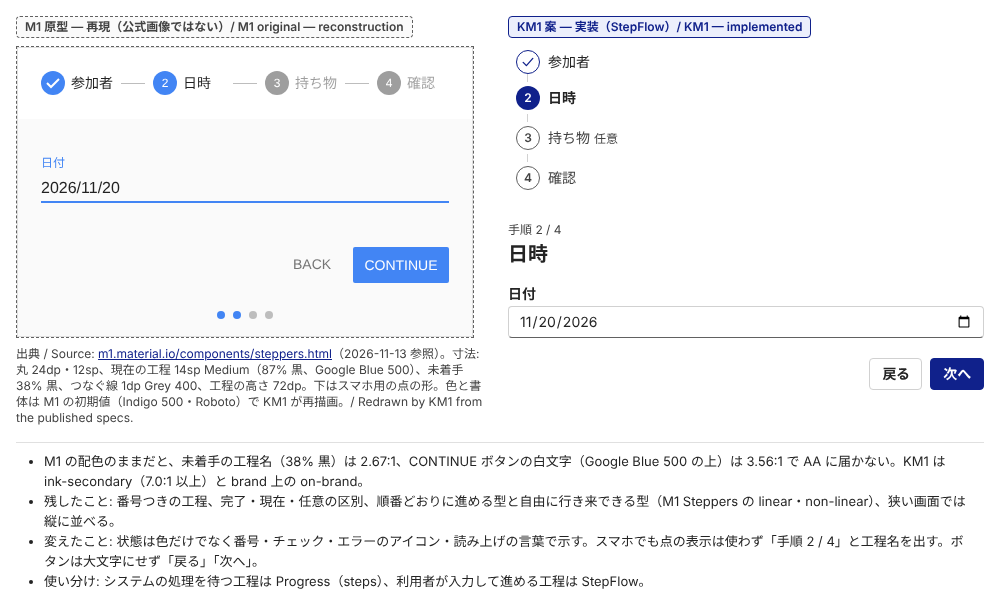

### [ConditionalField](ConditionalField/)

前の答えによって必要になる欄を、その答えのすぐ下に出す。

### [ContextualActionBar](ContextualActionBar/)

選んだ対象にだけ効く操作をまとめたバー。選んでいる間だけ件数と操作が出る。`List`・`ImageGrid`・`Table` で共通（`Table` の一括操作もこの部品で描く）

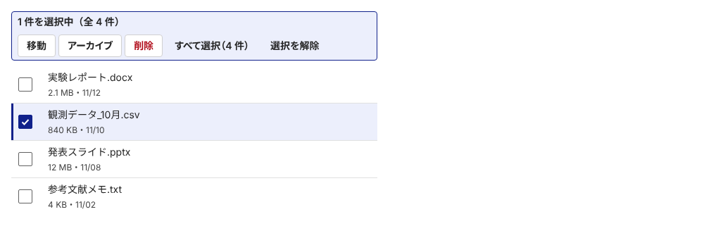

### [Cover](Cover/)

### [Density](Density/)

Card・Table・SortableList の 3 つの密度（compact・regular・spacious）を同じ画面で比べる見本。決まりは「トークン › 密度」（`tok

### [Dialog](Dialog/)

確認や短い入力のために、画面の上に重ねて出す。元の操作を止めてでも判断してほしいときだけ使う。

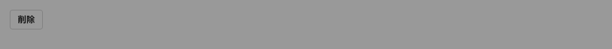

### [Drawer](Drawer/)

画面の端から出る大きめのパネル。絞り込みの条件、詳細、少し長い設定に使う。

### [EmptyState](EmptyState/)

まだ何も無い場所に出す案内。何が入る場所かと、最初の一歩を伝える。

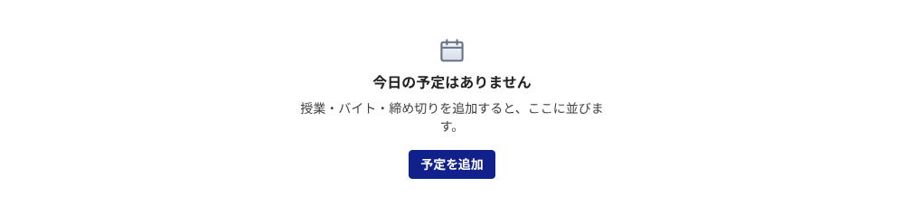

### [ErrorSummary](ErrorSummary/)

送信して誤りがあったとき、フォームの上に件数と誤りの一覧を出す。各行は該当の欄へのリンク。

### [ExpansionEditor](ExpansionEditor/)

一覧の中の 1 項目を、その場で開いて直す。閉じているときは項目名と今の値、開くと入力欄と「キャンセル」「保存」。M1 の Expansion panels の「軽い編集」を取り込

### [FileUpload](FileUpload/)

ファイルを選ぶ、またはドラッグして渡す欄。

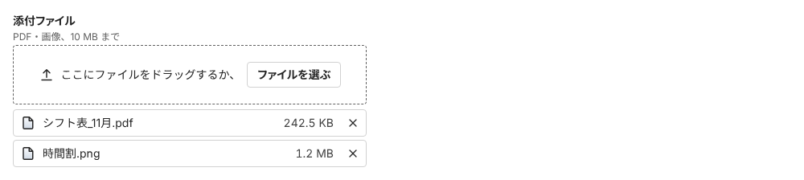

### [FormGrid](FormGrid/)

関係の強い短い欄を、広い画面でだけ 2 列に並べる。基本は 1 列。

### [FormGroup](FormGroup/)

フォームの中の 1 つのまとまりに見出しを付ける。間隔は「欄の間 < グループの間」になるよう決めてあり、枠や背景は付けない。全体の決まりは「画面の組み立て › フォーム」。

### [Icon](Icon/)

KM1 のアイコン（KM1-ICO-001）。KM1 の名前で引く 1 つのセットで、通常表示（線と淡い面）も選択・強調の塗りの形（Filled）も KM1 B 案で KM1 が描

### [IconTrial](IconTrial/)

KM1 B 案（調整版）の導入前と導入後の比較（KM1-ICO-001 §8）。試験導入した 6 種（検索・予定・フォルダ・削除・警告・通知）で見比べる。いまは全アイコンの通常表示

### [ImageGrid](ImageGrid/)

写真やファイルのように、見た目で見分けるものを格子に並べる。タイル全体が主操作、選択のチェックは別の押し場所。M1 の Grid lists を KM1 に合わせたもの。

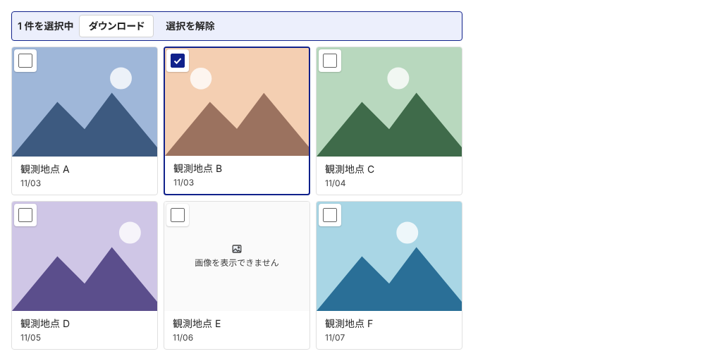

### [Input](Input/)

1 行のテキスト入力。ラベルは常に表示し、プレースホルダをラベル代わりにしない。

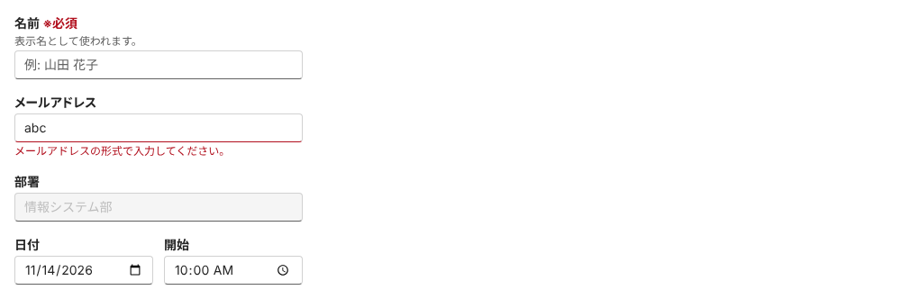

### [Link](Link/)

文中・文末のテキストリンク。常に下線を付け、色だけでリンクと分からせない。

### [List](List/)

同じ種類のものを縦に並べ、ざっと見て 1 つを選ぶ一覧。`List`・`ListItem`・`ListSection`（小見出しつきのまとまり）・`ListSectionHeade

### [Menu](Menu/)

ボタンを押すと開く操作の一覧。場所を取らずに、頻度の低い操作をまとめる。

### [Nav](Nav/)

画面を切り替えるメインのナビゲーション。狭い画面では下部のタブ、広い画面ではサイドバーになる。

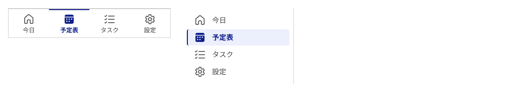

### [Pagination](Pagination/)

長い一覧をページに分けたときの、ページの移動。

### [Popover](Popover/)

ボタンの近くに出る、小さな作業用のパネル。表示の設定、短い補足、2〜3 項目の入力に使う。

### [Progress](Progress/)

進み具合や量を横棒で示す。処理の進行、達成度、ゲームのゲージに使う。

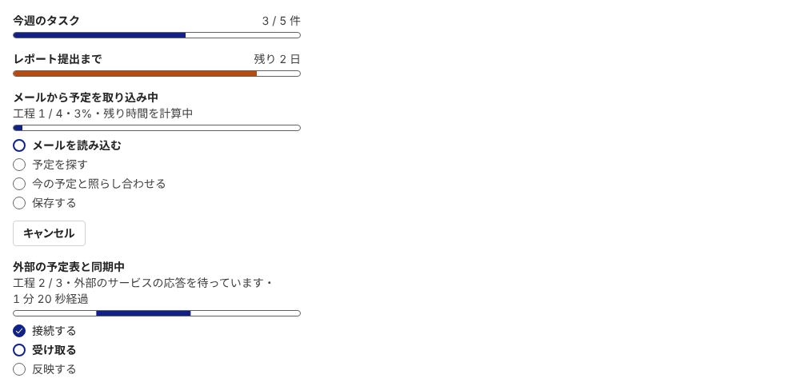

### [RadioGroup](RadioGroup/)

選択肢が 5 件以下で、1 つだけを選ぶとき。`fieldset` と `legend` でグループの名前を付け、矢印キーで移動できる（標準のラジオボタン）。

### [ScreenAddEvent](ScreenAddEvent/)

一覧と「予定を追加」ボタン、ドロワーの中のフォーム（エラーの一覧つき）、追加のお知らせ（Toast）を組み合わせた画面の例。

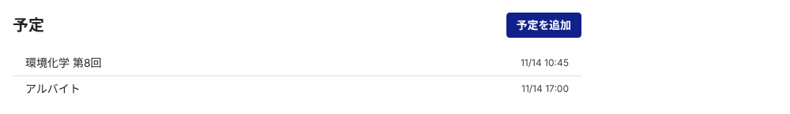

### [ScreenListEdit](ScreenListEdit/)

一覧・詳細・編集の組み合わせの例: 左の一覧で選び、右でその場の編集（ExpansionEditor）、まとめて削除は確認（Dialog）と「元に戻す」（Toast）。

### [ScreenOffline](ScreenOffline/)

通信が切れたときの画面の例: 警告（Alert）、時点の表示、未送信の件数、つながったら自動で送ってお知らせ（Toast）。

### [SearchBox](SearchBox/)

一覧や画面の中を探すための検索欄。

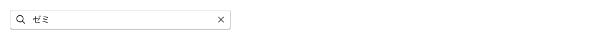

### [Select](Select/)

選択肢が 6 件以上のときに 1 つを選ぶ。ブラウザ標準の `<select>` を使うので、キーボードとスクリーンリーダーの操作は標準のまま動く。

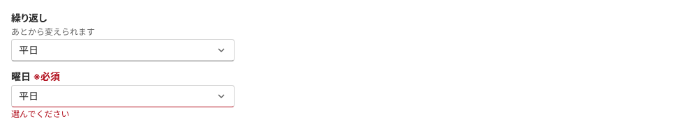

### [SelectionGuide](SelectionGuide/)

部品の選び方の早見図。「何をしたいか」から部品を選ぶ。文章版は「KM1 × M1」（`m1.md`）の「用途選択フロー」。

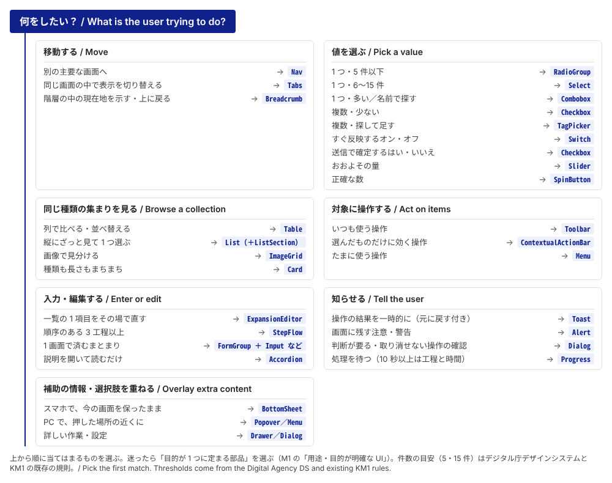

### [Skeleton](Skeleton/)

読み込み中に、これから出る内容のおおよその形を灰色で見せる。

### [Slider](Slider/)

範囲の中から、だいたいの値を選ぶつまみ。音量、通知の何分前、表示の密度など。

### [SortableList](SortableList/)

順番を入れ替えられる一覧。優先順位、表示の順番、手順の並べ替えに使う。

### [SpinButton](SpinButton/)

数を入れる欄。手で入力でき、−・＋や矢印キーで 1 つずつ増減できる。

### [Spinner](Spinner/)

短い待ち時間を示す回転する輪。ボタンの横や一覧の読み込み中に使う。

### [StepFlow](StepFlow/)

順序のある複数の工程を、利用者が入力しながら進める。工程の一覧（完了・現在・エラー・未完了）、今の工程の見出しと中身、「戻る」「次へ」。M1 の Steppers を KM1 に合

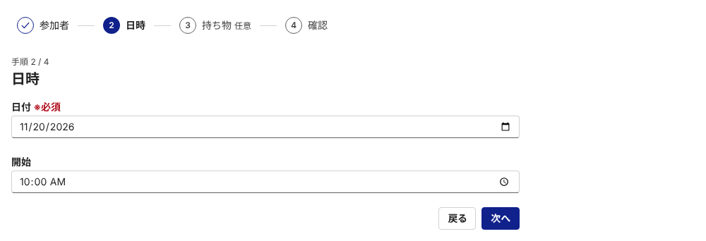

### [Switch](Switch/)

その場で効く設定のオン・オフ。押すとすぐ反映される。送信ボタンが要る設定には `Checkbox` を使う。

### [Table](Table/)

行と列でデータを見比べる表。

### [Tabs](Tabs/)

同じ階層の内容を切り替える。タブの並びは 2〜6 個まで。ページ遷移にはリンクを使う。

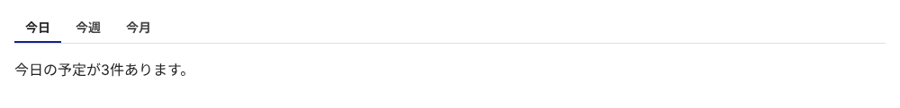

### [TagPicker](TagPicker/)

候補から複数を選ぶ欄。選んだものはタグとして並び、1 つずつ外せる。

### [Textarea](Textarea/)

複数行の文章を入力する欄。メモ、説明、貼り付けた文章の取り込みに使う。

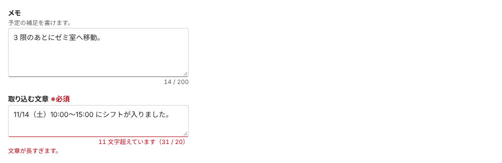

### [TimeGrid](TimeGrid/)

1 日または 1 週間の予定を、時刻の縦軸に並べる予定表。

### [Timetable](Timetable/)

曜日 × 時限の時間割。授業やシフトのように、毎週同じ枠に入る予定を見せる。

### [Toast](Toast/)

操作の結果や時刻の通知を、画面の下に一時的に出すお知らせ。

### [Toolbar](Toolbar/)

一覧や編集画面の上に、よく使う操作を横に並べる帯。

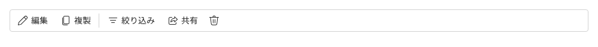

### [Tooltip](Tooltip/)

部品にマウスを乗せるかフォーカスしたときに出る、短い補足。

