# KM1 部品カタログ / Component catalog

見本 68 件を 16 のグループに分けて載せる。各部品の説明は部品フォルダの `README.md`、動く見本は `preview.html`。画像は `gen/shoot_previews.js` で撮ったもの（左がライト、右がダーク）。PDF 版は `dist/KM1_部品カタログ.pdf`。
*68 previews in 16 groups. Each folder has a README and a live `preview.html`; light on the left, dark on the right. PDF: `dist/KM1_部品カタログ.pdf`.*

## 目次 / Contents

- **表紙 / Cover**: [Cover](#cover)
- **操作 / Actions**: [Button](#button)・[Chip](#chip)・[Menu](#menu)・[Toolbar](#toolbar)
- **入力 / Forms**: [Checkbox](#checkbox)・[Combobox](#combobox)・[ConditionalField](#conditionalfield)・[ErrorSummary](#errorsummary)・[FileUpload](#fileupload)・[FormGrid](#formgrid)・[FormGroup](#formgroup)・[Input](#input)・[RadioGroup](#radiogroup)・[SearchBox](#searchbox)・[Select](#select)・[Slider](#slider)・[SpinButton](#spinbutton)・[Switch](#switch)・[TagPicker](#tagpicker)・[Textarea](#textarea)
- **一覧と選択 / Lists and selection**: [BottomSheet](#bottomsheet)・[ContextualActionBar](#contextualactionbar)・[ExpansionEditor](#expansioneditor)・[ImageGrid](#imagegrid)・[List](#list)・[StepFlow](#stepflow)
- **データ / Data**: [Avatar](#avatar)・[CategoryPattern](#categorypattern)・[SortableList](#sortablelist)・[Table](#table)
- **日付と時間 / Date and time**: [Calendar](#calendar)・[TimeGrid](#timegrid)・[Timetable](#timetable)
- **ナビゲーション / Navigation**: [Breadcrumb](#breadcrumb)・[Link](#link)・[Nav](#nav)・[Pagination](#pagination)・[Tabs](#tabs)
- **入れ物 / Containers**: [Accordion](#accordion)
- **面 / Surfaces**: [Card](#card)
- **重ねて出すもの / Overlays**: [Dialog](#dialog)・[Drawer](#drawer)・[Popover](#popover)・[Tooltip](#tooltip)
- **知らせ / Feedback**: [EmptyState](#emptystate)・[Progress](#progress)・[Skeleton](#skeleton)・[Spinner](#spinner)・[Toast](#toast)
- **状態 / Status**: [Alert](#alert)・[Badge](#badge)
- **アイコン / Icons**: [AppIcon](#appicon)・[Icon](#icon)・[IconTrial](#icontrial)
- **密度 / Density**: [Density](#density)
- **画面の例 / Screen patterns**: [ScreenAddEvent](#screenaddevent)・[ScreenListEdit](#screenlistedit)・[ScreenOffline](#screenoffline)・[ScreenToday](#screentoday)
- **M1 比較 / M1 comparison**: [CompareBottomSheet](#comparebottomsheet)・[CompareExpansion](#compareexpansion)・[CompareFAB](#comparefab)・[CompareGrid](#comparegrid)・[CompareList](#comparelist)・[CompareSelection](#compareselection)・[CompareStepper](#comparestepper)・[SelectionGuide](#selectionguide)

## 表紙 / Cover

### Cover

 → [Cover/](Cover/)

<table><tr><td valign="top">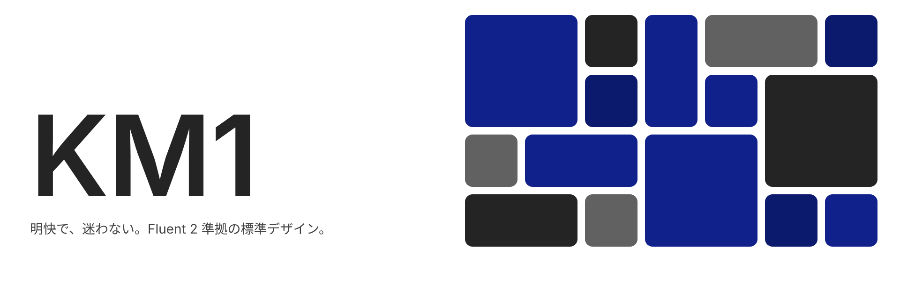</td><td valign="top">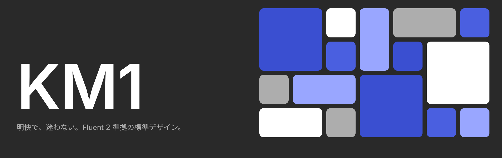</td></tr></table>

## 操作 / Actions

### Button

操作を実行するボタン。1 画面にプライマリ（`appearance="primary"`）は 1 つだけ。 → [Button/](Button/)

<table><tr><td valign="top">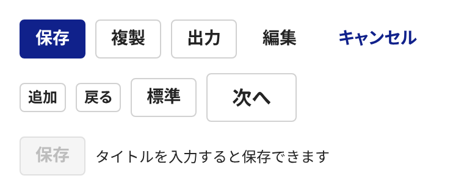</td><td valign="top">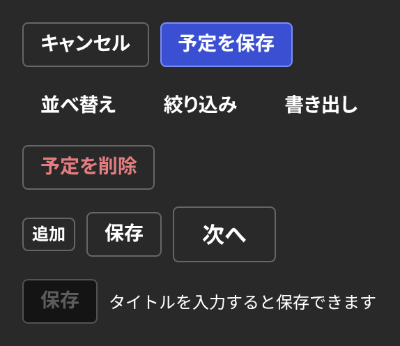</td></tr></table>

### Chip

押して切り替える小さな絞り込みボタン。一覧のフィルターや、複数選べる分類に使う。 → [Chip/](Chip/)

<table><tr><td valign="top"></td><td valign="top">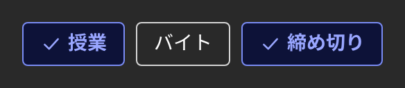</td></tr></table>

### Menu

ボタンを押すと開く操作の一覧。場所を取らずに、頻度の低い操作をまとめる。 → [Menu/](Menu/)

<table><tr><td valign="top">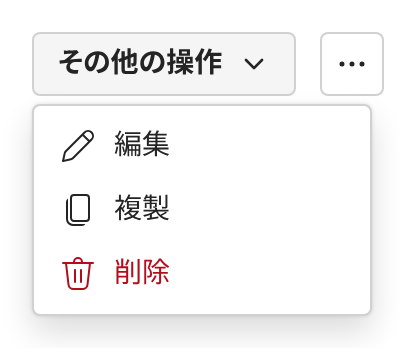</td><td valign="top">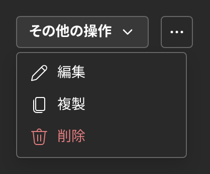</td></tr></table>

### Toolbar

一覧や編集画面の上に、よく使う操作を横に並べる帯。 → [Toolbar/](Toolbar/)

<table><tr><td valign="top"></td><td valign="top">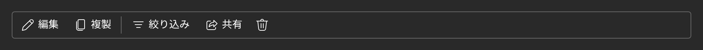</td></tr></table>

## 入力 / Forms

### Checkbox

複数選択や同意のためのチェックボックス。ラベルは必ず付け、ラベルをクリックしても切り替わる。 → [Checkbox/](Checkbox/)

<table><tr><td valign="top">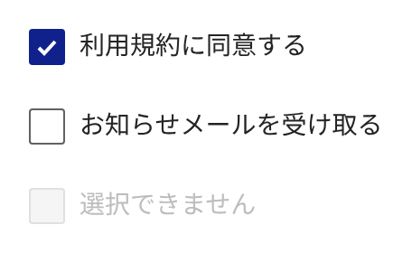</td><td valign="top">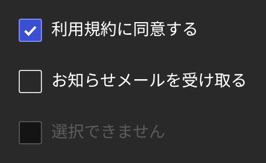</td></tr></table>

### Combobox

入力して候補を絞り込み、1 つを選ぶ欄。選択肢が多い（6 件以上）ときに使う。 → [Combobox/](Combobox/)

<table><tr><td valign="top"></td><td valign="top">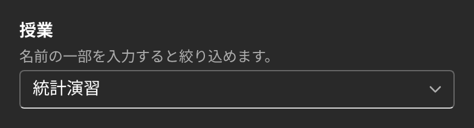</td></tr></table>

### ConditionalField

前の答えによって必要になる欄を、その答えのすぐ下に出す。 → [ConditionalField/](ConditionalField/)

<table><tr><td valign="top">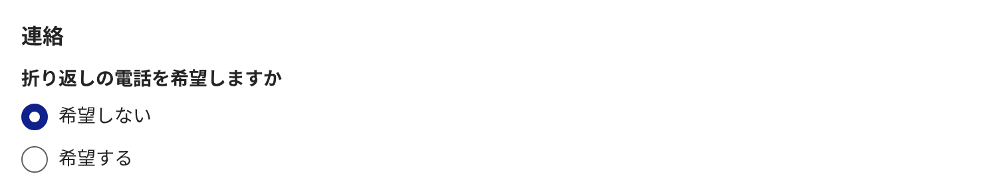</td><td valign="top">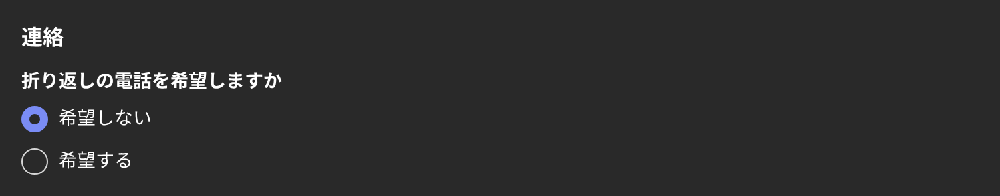</td></tr></table>

### ErrorSummary

送信して誤りがあったとき、フォームの上に件数と誤りの一覧を出す。各行は該当の欄へのリンク。 → [ErrorSummary/](ErrorSummary/)

<table><tr><td valign="top">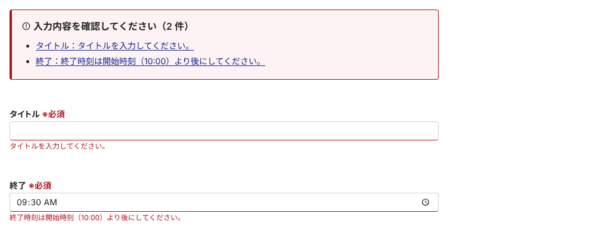</td><td valign="top">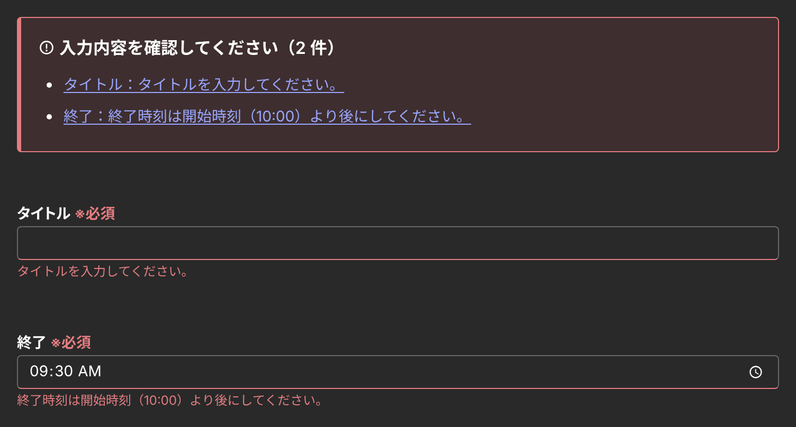</td></tr></table>

### FileUpload

ファイルを選ぶ、またはドラッグして渡す欄。 → [FileUpload/](FileUpload/)

<table><tr><td valign="top"></td><td valign="top">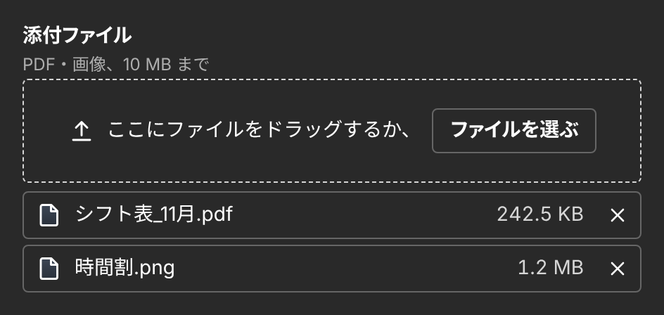</td></tr></table>

### FormGrid

関係の強い短い欄を、広い画面でだけ 2 列に並べる。基本は 1 列。 → [FormGrid/](FormGrid/)

<table><tr><td valign="top">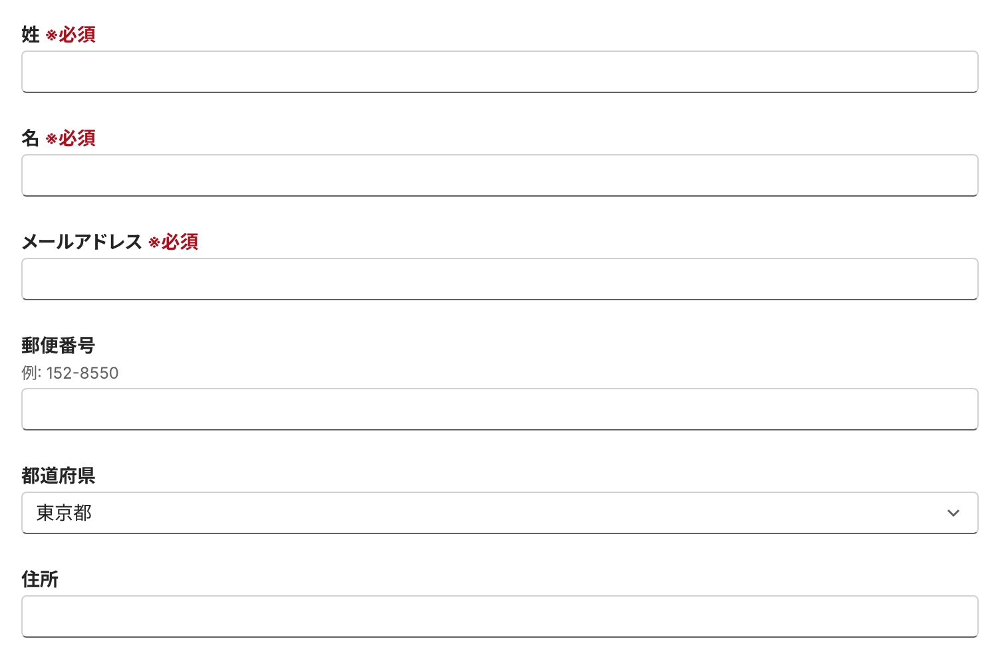</td><td valign="top">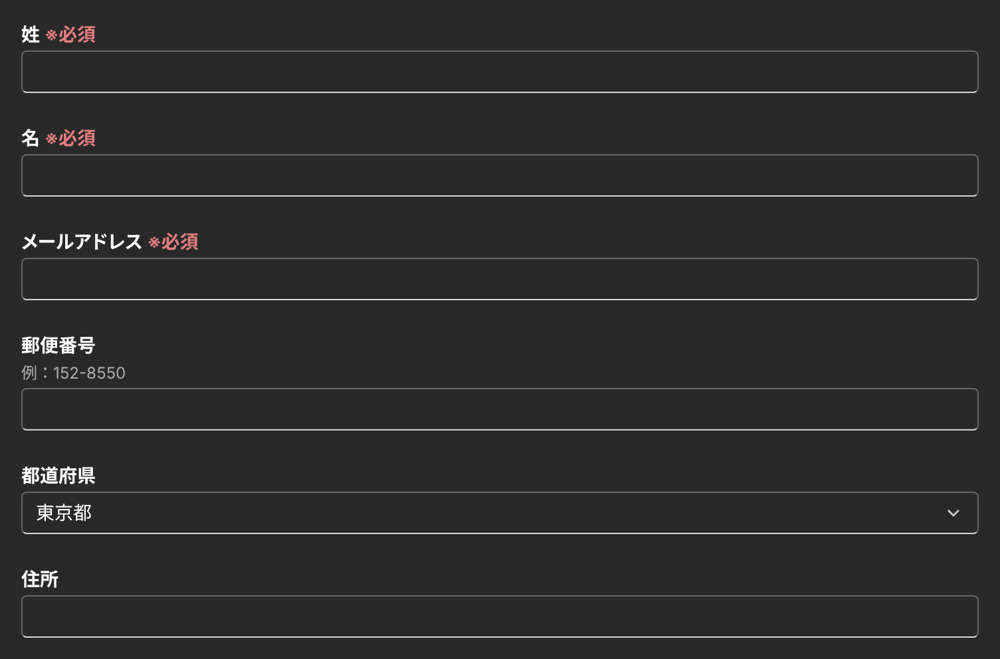</td></tr></table>

### FormGroup

フォームの中の 1 つのまとまりに見出しを付ける。間隔は「欄の間 < グループの間」になるよう決めてあり、枠や背景は付けない。全体の決まりは「画面の組み立て › フォーム」。 → [FormGroup/](FormGroup/)

<table><tr><td valign="top">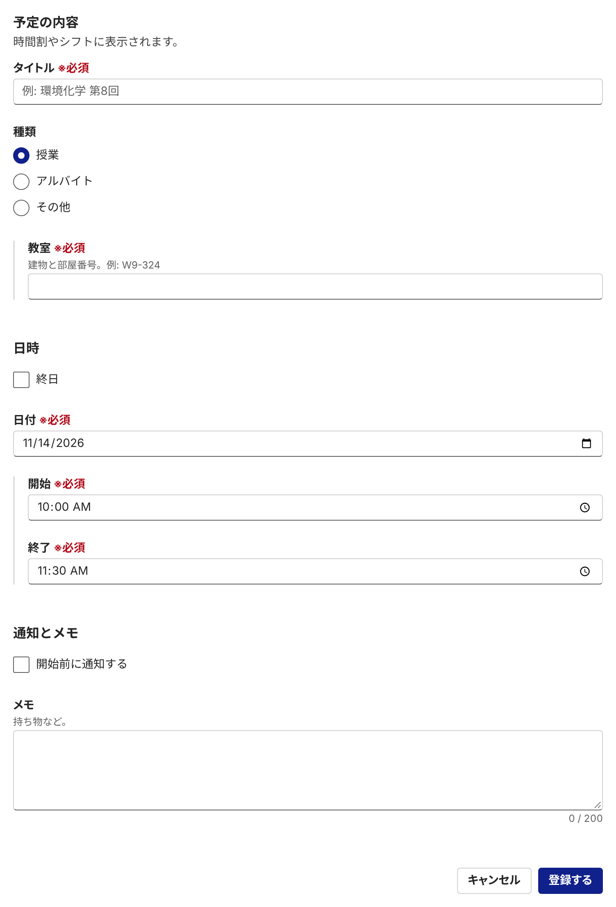</td><td valign="top">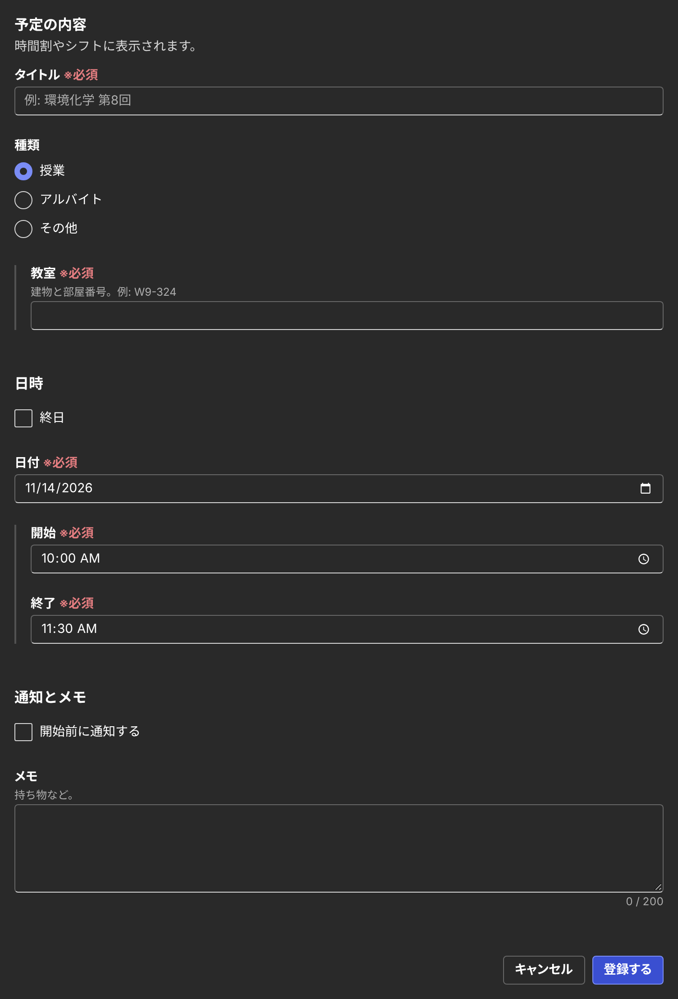</td></tr></table>

### Input

1 行のテキスト入力。ラベルは常に表示し、プレースホルダをラベル代わりにしない。 → [Input/](Input/)

<table><tr><td valign="top"></td><td valign="top">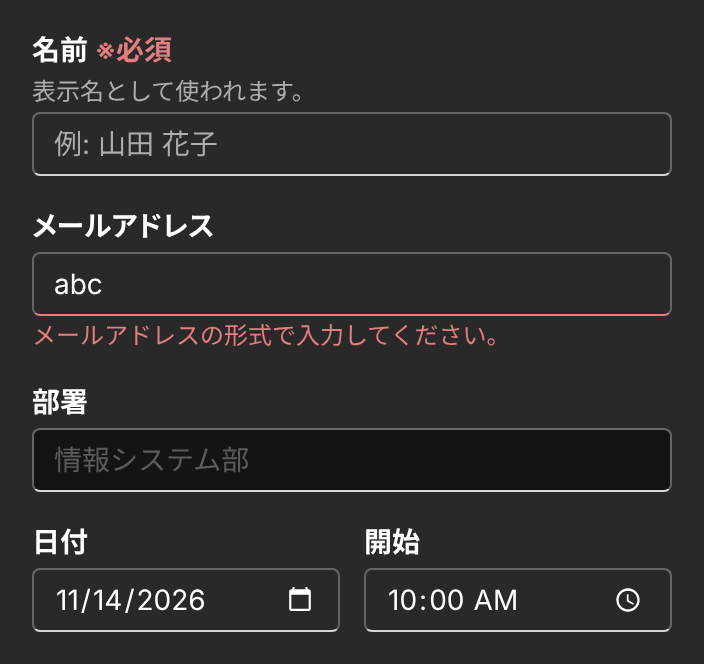</td></tr></table>

### RadioGroup

選択肢が 5 件以下で、1 つだけを選ぶとき。`fieldset` と `legend` でグループの名前を付け、矢印キーで移動できる（標準のラジオボタン）。 → [RadioGroup/](RadioGroup/)

<table><tr><td valign="top">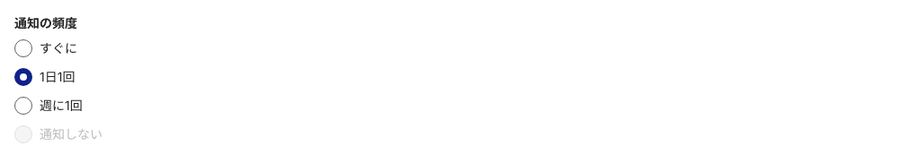</td><td valign="top">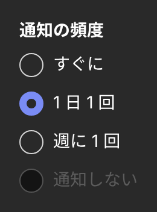</td></tr></table>

### SearchBox

一覧や画面の中を探すための検索欄。 → [SearchBox/](SearchBox/)

<table><tr><td valign="top"></td><td valign="top">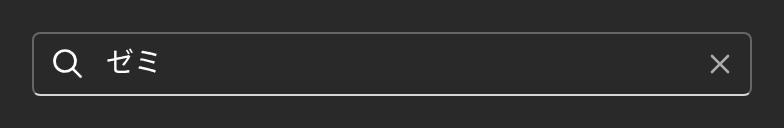</td></tr></table>

### Select

選択肢が 6 件以上のときに 1 つを選ぶ。ブラウザ標準の `<select>` を使うので、キーボードとスクリーンリーダーの操作は標準のまま動く。 → [Select/](Select/)

<table><tr><td valign="top"></td><td valign="top">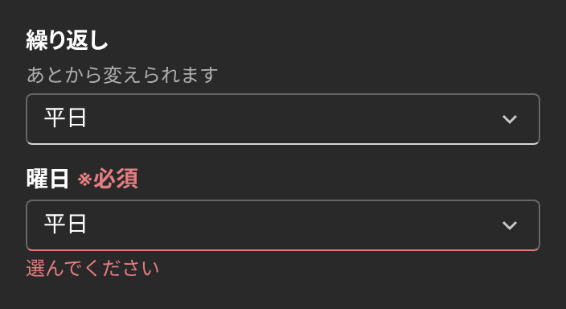</td></tr></table>

### Slider

範囲の中から、だいたいの値を選ぶつまみ。音量、通知の何分前、表示の密度など。 → [Slider/](Slider/)

<table><tr><td valign="top"></td><td valign="top">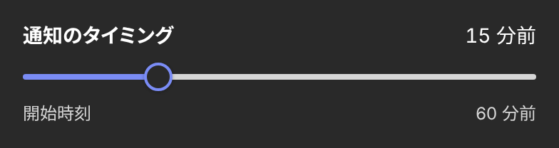</td></tr></table>

### SpinButton

数を入れる欄。手で入力でき、−・＋や矢印キーで 1 つずつ増減できる。 → [SpinButton/](SpinButton/)

<table><tr><td valign="top"></td><td valign="top">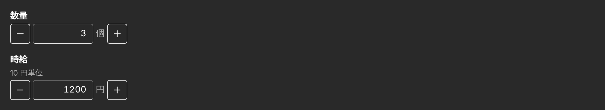</td></tr></table>

### Switch

その場で効く設定のオン・オフ。押すとすぐ反映される。送信ボタンが要る設定には `Checkbox` を使う。 → [Switch/](Switch/)

<table><tr><td valign="top">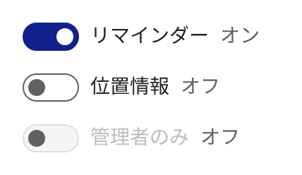</td><td valign="top">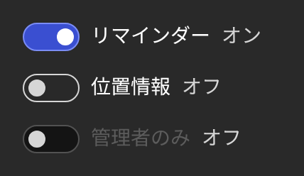</td></tr></table>

### TagPicker

候補から複数を選ぶ欄。選んだものはタグとして並び、1 つずつ外せる。 → [TagPicker/](TagPicker/)

<table><tr><td valign="top"></td><td valign="top">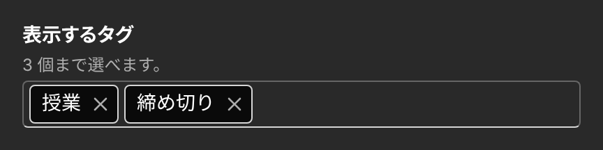</td></tr></table>

### Textarea

複数行の文章を入力する欄。メモ、説明、貼り付けた文章の取り込みに使う。 → [Textarea/](Textarea/)

<table><tr><td valign="top"></td><td valign="top">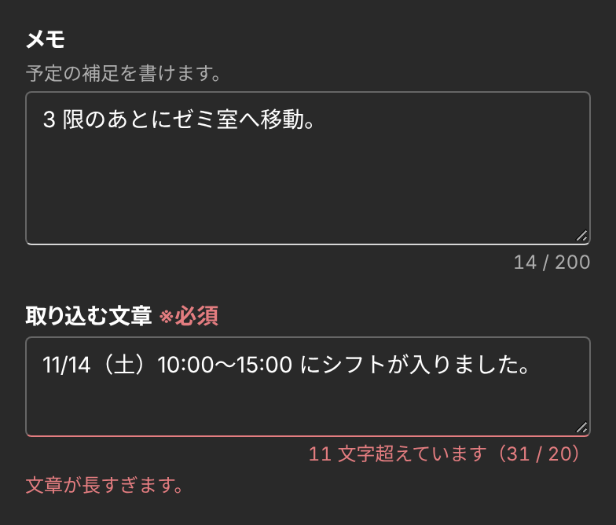</td></tr></table>

## 一覧と選択 / Lists and selection

### BottomSheet

狭い画面で、今の画面を保ったまま、補助の情報や選択肢を下から出す。モーダル（`modal`、既定）と持続型（`persistent`）がある。M1 の Bottom sheets を KM1 に合わせたもの。 → [BottomSheet/](BottomSheet/)

<table><tr><td valign="top"></td><td valign="top">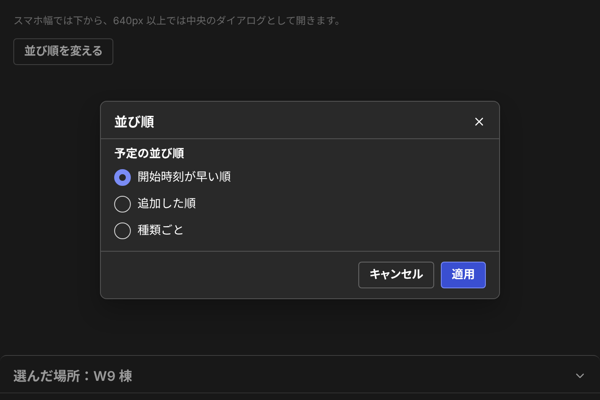</td></tr></table>

### ContextualActionBar

選んだ対象にだけ効く操作をまとめたバー。選んでいる間だけ件数と操作が出る。`List`・`ImageGrid`・`Table` で共通（`Table` の一括操作もこの部品で描く）。選択の状態は `useSelection` で持てる。 → [ContextualActionBar/](ContextualActionBar/)

<table><tr><td valign="top"></td><td valign="top">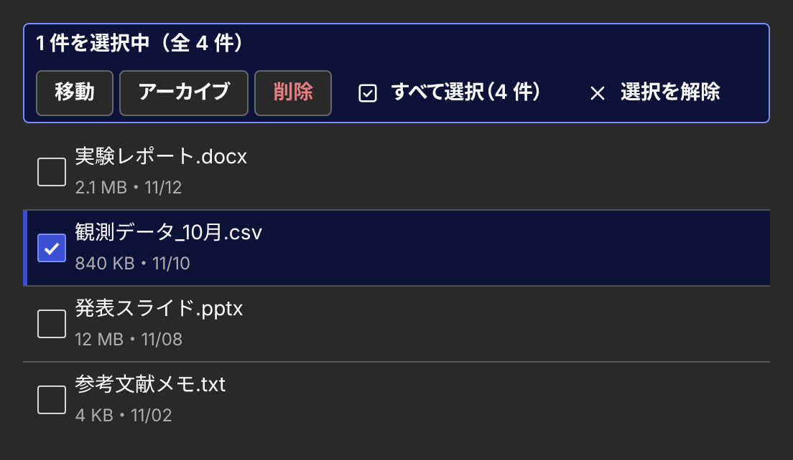</td></tr></table>

### ExpansionEditor

一覧の中の 1 項目を、その場で開いて直す。閉じているときは項目名と今の値、開くと入力欄と「キャンセル」「保存」。M1 の Expansion panels の「軽い編集」を取り込んだもの。閲覧だけの開閉は `Accordion`。 → [ExpansionEditor/](ExpansionEditor/)

<table><tr><td valign="top">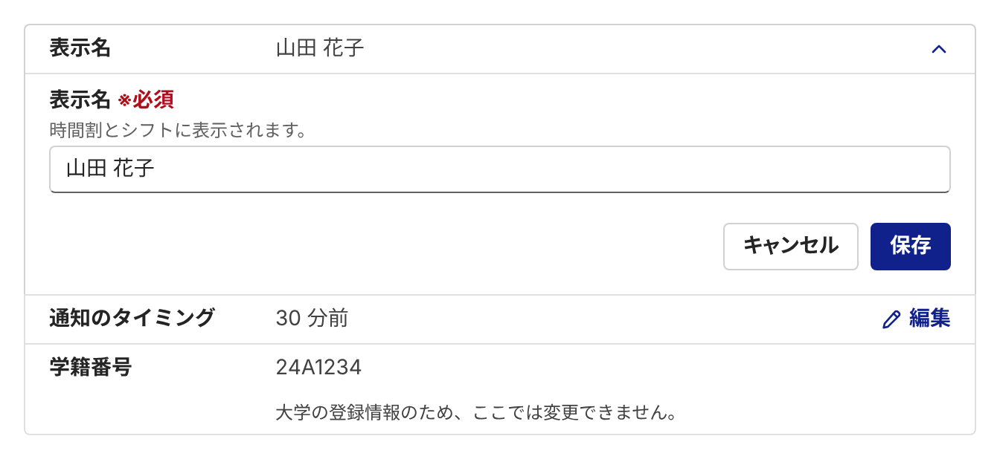</td><td valign="top">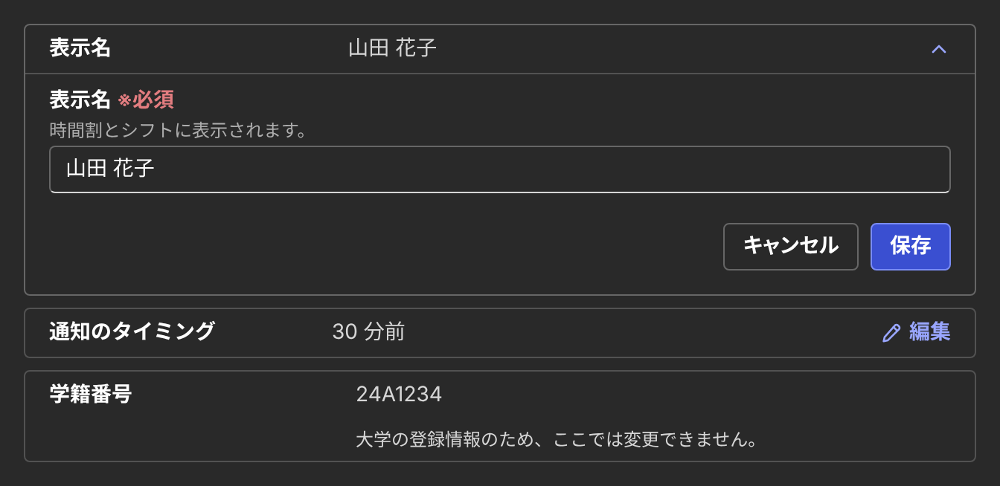</td></tr></table>

### ImageGrid

写真やファイルのように、見た目で見分けるものを格子に並べる。タイル全体が主操作、選択のチェックは別の押し場所。M1 の Grid lists を KM1 に合わせたもの。 → [ImageGrid/](ImageGrid/)

<table><tr><td valign="top"></td><td valign="top">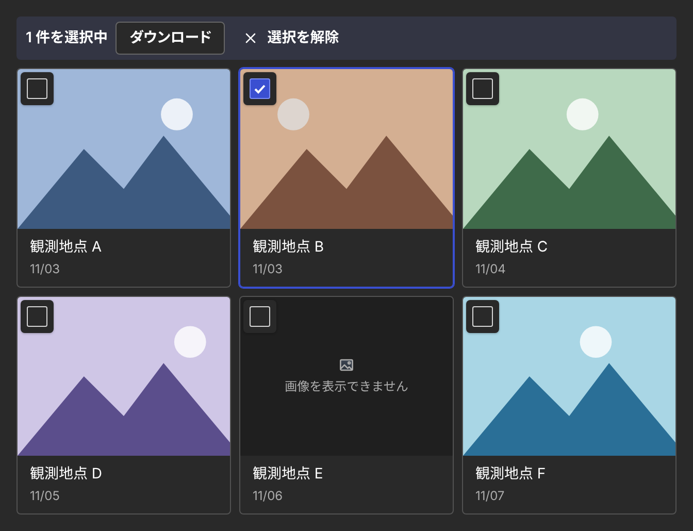</td></tr></table>

### List

同じ種類のものを縦に並べ、ざっと見て 1 つを選ぶ一覧。`List`・`ListItem`・`ListSection`（小見出しつきのまとまり）・`ListSectionHeader`（小見出しだけ）からなる。M1 の Lists・Lists: Controls・Subheaders の考え方を、KM1 の見た目で実装したもの（KM1-M1-001）。 → [List/](List/)

<table><tr><td valign="top">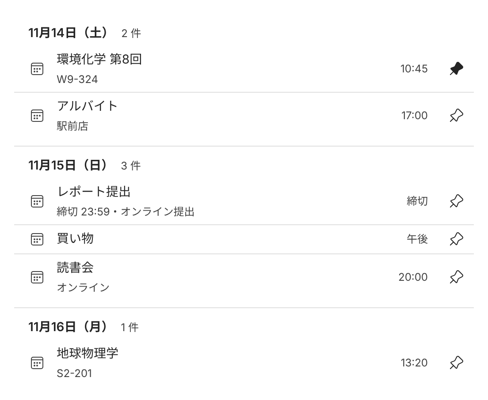</td><td valign="top">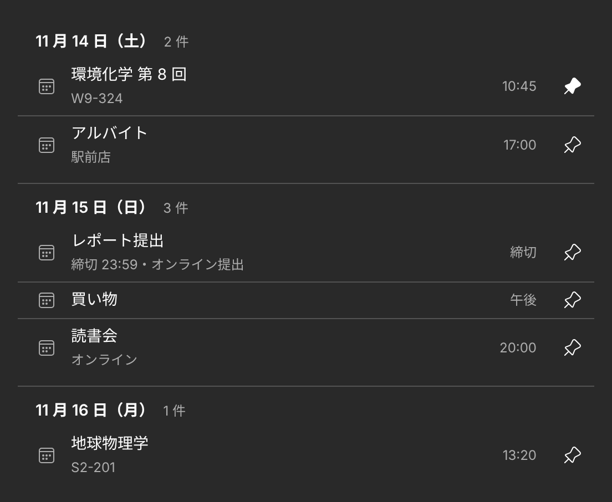</td></tr></table>

### StepFlow

順序のある複数の工程を、利用者が入力しながら進める。工程の一覧（完了・現在・エラー・未完了）、今の工程の見出しと中身、「戻る」「次へ」。M1 の Steppers を KM1 に合わせたもの。システムの処理を待つ工程は `Progress`（`steps`）。 → [StepFlow/](StepFlow/)

<table><tr><td valign="top"></td><td valign="top">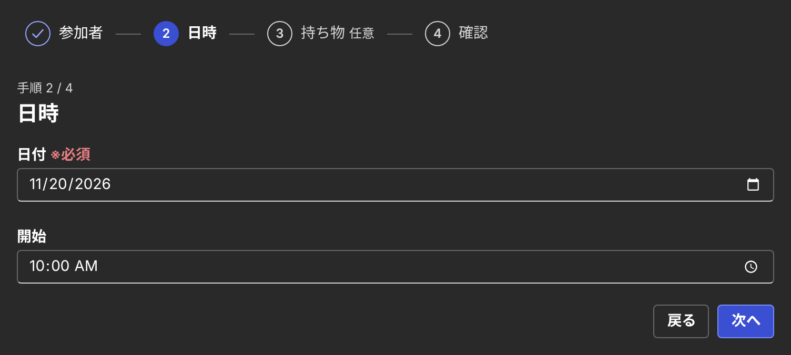</td></tr></table>

## データ / Data

### Avatar

人や場所を、写真か頭文字で小さく示す丸。 → [Avatar/](Avatar/)

<table><tr><td valign="top"></td><td valign="top"></td></tr></table>

### CategoryPattern

分類を**色 × 模様**で区別するための部品。`cat-*` の 18 色に 8 つの模様（塗り・横線・縦線・斜線・格子・斜め格子・点・市松）を組み合わせ、144 通りにする。色が見分けにくい人や白黒の印刷でも、模様で区別できる（WCAG 1.4.1）。 → [CategoryPattern/](CategoryPattern/)

<table><tr><td valign="top"></td><td valign="top">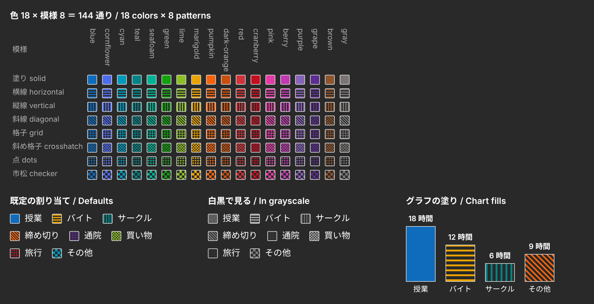</td></tr></table>

### SortableList

順番を入れ替えられる一覧。優先順位、表示の順番、手順の並べ替えに使う。 → [SortableList/](SortableList/)

<table><tr><td valign="top">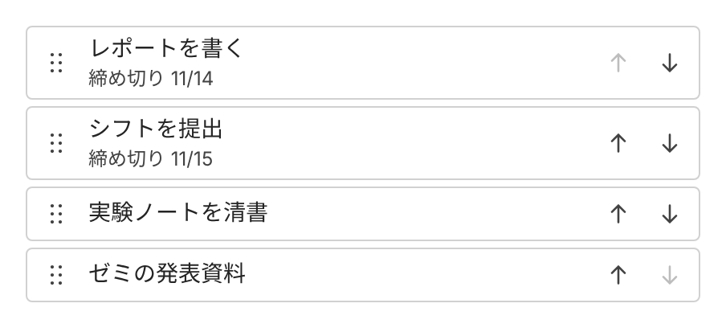</td><td valign="top">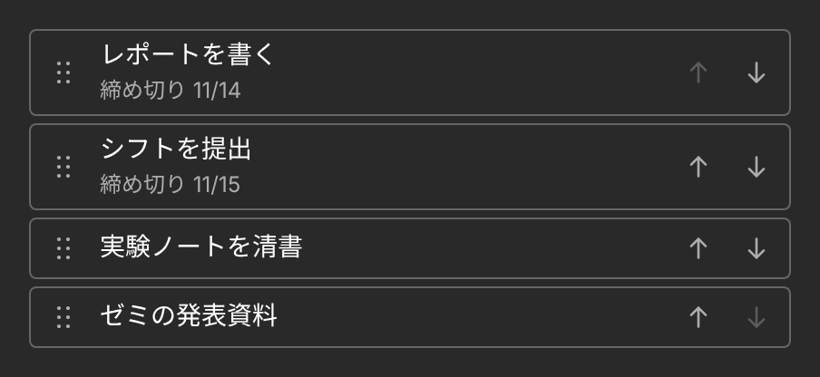</td></tr></table>

### Table

行と列でデータを見比べる表。 → [Table/](Table/)

<table><tr><td valign="top">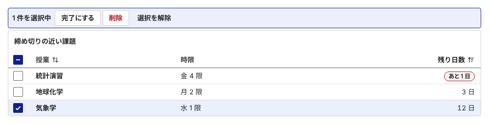</td><td valign="top">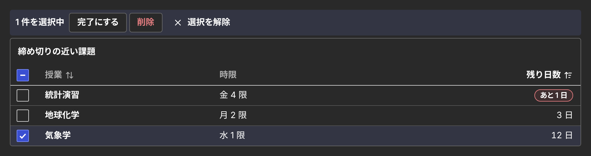</td></tr></table>

## 日付と時間 / Date and time

### Calendar

月の表から日付を 1 つ選ぶ。予定のある日に印を付けられる。 → [Calendar/](Calendar/)

<table><tr><td valign="top">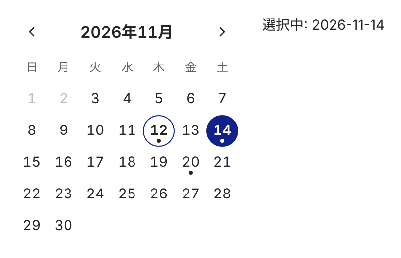</td><td valign="top">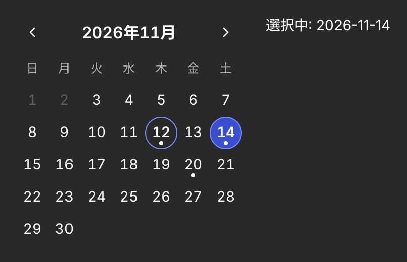</td></tr></table>

### TimeGrid

1 日または 1 週間の予定を、時刻の縦軸に並べる予定表。 → [TimeGrid/](TimeGrid/)

<table><tr><td valign="top">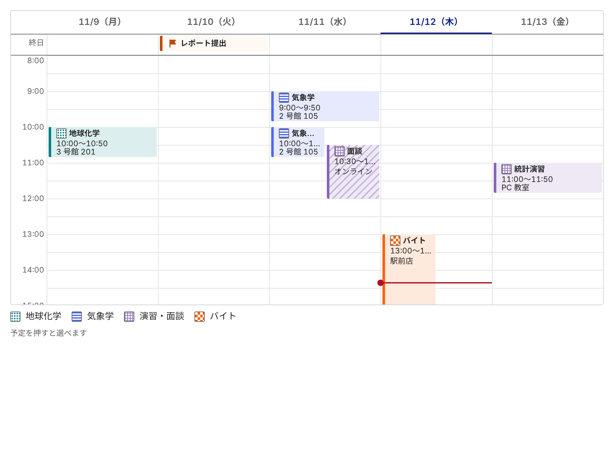</td><td valign="top">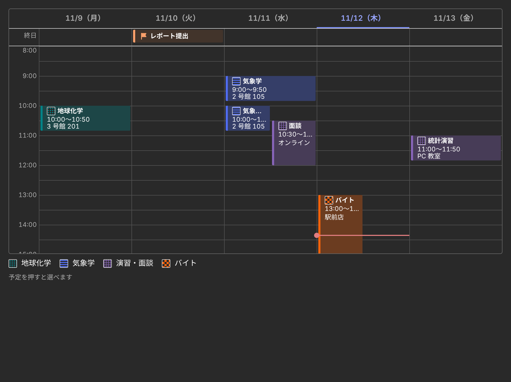</td></tr></table>

### Timetable

曜日 × 時限の時間割。授業やシフトのように、毎週同じ枠に入る予定を見せる。 → [Timetable/](Timetable/)

<table><tr><td valign="top">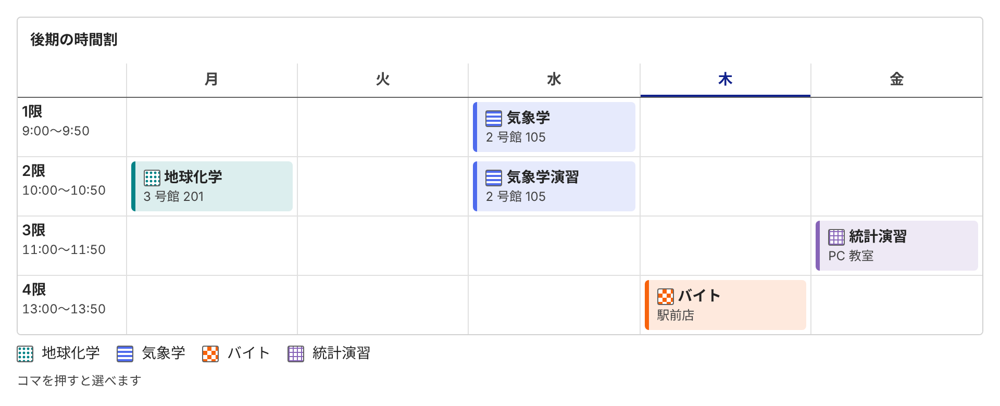</td><td valign="top">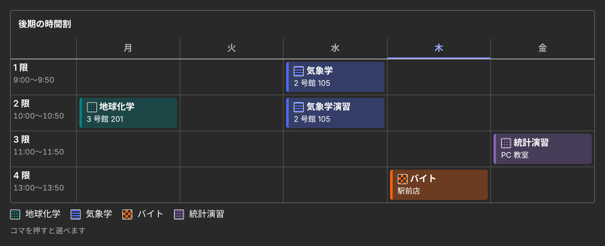</td></tr></table>

## ナビゲーション / Navigation

### Breadcrumb

今いる画面が、全体のどこにあるかを示す道しるべ。3 階層以上ある画面で使う。 → [Breadcrumb/](Breadcrumb/)

<table><tr><td valign="top"></td><td valign="top"></td></tr></table>

### Link

文中・文末のテキストリンク。常に下線を付け、色だけでリンクと分からせない。 → [Link/](Link/)

<table><tr><td valign="top"></td><td valign="top"></td></tr></table>

### Nav

画面を切り替えるメインのナビゲーション。狭い画面では下部のタブ、広い画面ではサイドバーになる。 → [Nav/](Nav/)

<table><tr><td valign="top"></td><td valign="top"></td></tr></table>

### Pagination

長い一覧をページに分けたときの、ページの移動。 → [Pagination/](Pagination/)

<table><tr><td valign="top"></td><td valign="top"></td></tr></table>

### Tabs

同じ階層の内容を切り替える。タブの並びは 2〜6 個まで。ページ遷移にはリンクを使う。 → [Tabs/](Tabs/)

<table><tr><td valign="top"></td><td valign="top"></td></tr></table>

## 入れ物 / Containers

### Accordion

見出しを押して、中身を開いたり閉じたりする一覧。よくある質問、設定のまとまり、長い説明の折りたたみに使う。 → [Accordion/](Accordion/)

<table><tr><td valign="top"></td><td valign="top"></td></tr></table>

## 面 / Surfaces

### Card

関連する情報をまとめる面。`surface` 上に `stroke` の 1px の縁、`radius-lg`、内側は `container-card-padding-regular`（= `space-lg`）。影は付けない。 → [Card/](Card/)

<table><tr><td valign="top"></td><td valign="top"></td></tr></table>

## 重ねて出すもの / Overlays

### Dialog

確認や短い入力のために、画面の上に重ねて出す。元の操作を止めてでも判断してほしいときだけ使う。 → [Dialog/](Dialog/)

<table><tr><td valign="top"></td><td valign="top"></td></tr></table>

### Drawer

画面の端から出る大きめのパネル。絞り込みの条件、詳細、少し長い設定に使う。 → [Drawer/](Drawer/)

<table><tr><td valign="top"></td><td valign="top"></td></tr></table>

### Popover

ボタンの近くに出る、小さな作業用のパネル。表示の設定、短い補足、2〜3 項目の入力に使う。 → [Popover/](Popover/)

<table><tr><td valign="top"></td><td valign="top"></td></tr></table>

### Tooltip

部品にマウスを乗せるかフォーカスしたときに出る、短い補足。 → [Tooltip/](Tooltip/)

<table><tr><td valign="top"></td><td valign="top"></td></tr></table>

## 知らせ / Feedback

### EmptyState

まだ何も無い場所に出す案内。何が入る場所かと、最初の一歩を伝える。中身が入るはずの場所に、左寄せの文で置く。 → [EmptyState/](EmptyState/)

<table><tr><td valign="top"></td><td valign="top"></td></tr></table>

### Progress

進み具合や量を横棒で示す。処理の進行、達成度、ゲームのゲージに使う。 → [Progress/](Progress/)

<table><tr><td valign="top"></td><td valign="top"></td></tr></table>

### Skeleton

読み込み中に、これから出る内容のおおよその形を灰色で見せる。 → [Skeleton/](Skeleton/)

<table><tr><td valign="top"></td><td valign="top"></td></tr></table>

### Spinner

短い待ち時間を示す回転する輪。ボタンの横や一覧の読み込み中に使う。 → [Spinner/](Spinner/)

<table><tr><td valign="top"></td><td valign="top"></td></tr></table>

### Toast

操作の結果や時刻の通知を、画面の下に一時的に出すお知らせ。 → [Toast/](Toast/)

<table><tr><td valign="top"></td><td valign="top"></td></tr></table>

## 状態 / Status

### Alert

状態をユーザーに知らせるバナー。色に加えて、アイコンと「情報」「成功」「注意」「エラー」の文言を必ず併記する。 → [Alert/](Alert/)

<table><tr><td valign="top"></td><td valign="top"></td></tr></table>

### Badge

状態や件数を示す小さなラベル。丸型（`radius-circular`）。 → [Badge/](Badge/)

<table><tr><td valign="top"></td><td valign="top"></td></tr></table>

## アイコン / Icons

### AppIcon

KM1 のアプリアイコンとファビコン（KM1-ICO-001 §6）。紺（`brand`）の正方形に白の「KM1」と表紙のしるし。`icons/km1_appicon.py` が 1 枚の元の絵から Web・Android・iOS・Windows の大きさを全部書き出す。 → [AppIcon/](AppIcon/)

<table><tr><td valign="top"></td><td valign="top"></td></tr></table>

### Icon

KM1 のアイコン（KM1-ICO-001）。KM1 の名前で引く 1 つのセットで、通常表示（線と淡い面）も選択・強調の塗りの形（Filled）も KM1 B 案で KM1 が描いた形（もとにした絵は Fluent System Icons、Microsoft、MIT）。描き方と一覧は本編「アイコン」の章。 → [Icon/](Icon/)

<table><tr><td valign="top"></td><td valign="top"></td></tr></table>

### IconTrial

KM1 B 案（調整版）の導入前と導入後の比較（KM1-ICO-001 §8）。試験導入した 6 種（検索・予定・フォルダ・削除・警告・通知）で見比べる。いまは全アイコンの通常表示が B 案。通常の `Icon` の呼び出し（`h(Icon,{name:'calendar'})`）でそのまま出る。 → [IconTrial/](IconTrial/)

<table><tr><td valign="top"></td><td valign="top"></td></tr></table>

## 密度 / Density

### Density

Card・Table・SortableList の 3 つの密度（compact・regular・spacious）を同じ画面で比べる見本。決まりは「トークン › 密度」（`tokens.md`）。 → [Density/](Density/)

<table><tr><td valign="top"></td><td valign="top"></td></tr></table>

## 画面の例 / Screen patterns

### ScreenAddEvent

一覧と「予定を追加」ボタン、ドロワーの中のフォーム（エラーの一覧つき）、追加のお知らせ（Toast）を組み合わせた画面の例。 → [ScreenAddEvent/](ScreenAddEvent/)

<table><tr><td valign="top"></td><td valign="top"></td></tr></table>

### ScreenListEdit

一覧・詳細・編集の組み合わせの例: 左の一覧で選び、右でその場の編集（ExpansionEditor）、まとめて削除は確認（Dialog）と「元に戻す」（Toast）。 → [ScreenListEdit/](ScreenListEdit/)

<table><tr><td valign="top"></td><td valign="top"></td></tr></table>

### ScreenOffline

通信が切れたときの画面の例: 警告（Alert）、時点の表示、未送信の件数、つながったら自動で送ってお知らせ（Toast）。 → [ScreenOffline/](ScreenOffline/)

<table><tr><td valign="top"></td><td valign="top"></td></tr></table>

### ScreenToday

スケジュール確認アプリの「今日」の画面の例。「画面の組み立て › わかりやすさ」の順番で、部品からではなく、開いた人が最初に知りたいことから作った。 → [ScreenToday/](ScreenToday/)

<table><tr><td valign="top"></td><td valign="top"></td></tr></table>

## M1 比較 / M1 comparison

### CompareBottomSheet

M1（初代 Material Design）の原型を寸法から再描画したもの（左）と、KM1 に合わせた案（右）の比較。左は公式の画像ではなく、出典の寸法をもとに KM1 が描いた参考の再現。判断の理由は「KM1 × M1」（`m1.md`）。 → [CompareBottomSheet/](CompareBottomSheet/)

<table><tr><td valign="top"></td><td valign="top"></td></tr></table>

### CompareExpansion

M1（初代 Material Design）の原型を寸法から再描画したもの（左）と、KM1 に合わせた案（右）の比較。左は公式の画像ではなく、出典の寸法をもとに KM1 が描いた参考の再現。判断の理由は「KM1 × M1」（`m1.md`）。 → [CompareExpansion/](CompareExpansion/)

<table><tr><td valign="top"></td><td valign="top"></td></tr></table>

### CompareFAB

M1（初代 Material Design）の原型を寸法から再描画したもの（左）と、KM1 に合わせた案（右）の比較。左は公式の画像ではなく、出典の寸法をもとに KM1 が描いた参考の再現。判断の理由は「KM1 × M1」（`m1.md`）。 → [CompareFAB/](CompareFAB/)

<table><tr><td valign="top"></td><td valign="top"></td></tr></table>

### CompareGrid

M1（初代 Material Design）の原型を寸法から再描画したもの（左）と、KM1 に合わせた案（右）の比較。左は公式の画像ではなく、出典の寸法をもとに KM1 が描いた参考の再現。判断の理由は「KM1 × M1」（`m1.md`）。 → [CompareGrid/](CompareGrid/)

<table><tr><td valign="top"></td><td valign="top"></td></tr></table>

### CompareList

M1（初代 Material Design）の原型を寸法から再描画したもの（左）と、KM1 に合わせた案（右）の比較。左は公式の画像ではなく、出典の寸法をもとに KM1 が描いた参考の再現。判断の理由は「KM1 × M1」（`m1.md`）。 → [CompareList/](CompareList/)

<table><tr><td valign="top"></td><td valign="top"></td></tr></table>

### CompareSelection

M1（初代 Material Design）の原型を寸法から再描画したもの（左）と、KM1 に合わせた案（右）の比較。左は公式の画像ではなく、出典の寸法をもとに KM1 が描いた参考の再現。判断の理由は「KM1 × M1」（`m1.md`）。 → [CompareSelection/](CompareSelection/)

<table><tr><td valign="top"></td><td valign="top"></td></tr></table>

### CompareStepper

M1（初代 Material Design）の原型を寸法から再描画したもの（左）と、KM1 に合わせた案（右）の比較。左は公式の画像ではなく、出典の寸法をもとに KM1 が描いた参考の再現。判断の理由は「KM1 × M1」（`m1.md`）。 → [CompareStepper/](CompareStepper/)

<table><tr><td valign="top"></td><td valign="top"></td></tr></table>

### SelectionGuide

部品の選び方の早見図。「何をしたいか」から部品を選ぶ。文章版は「KM1 × M1」（`m1.md`）の「用途選択フロー」。 → [SelectionGuide/](SelectionGuide/)

<table><tr><td valign="top"></td><td valign="top"></td></tr></table>
