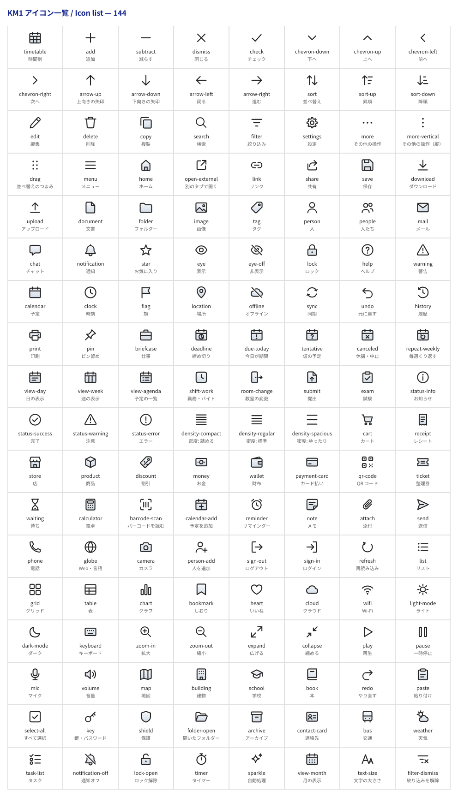
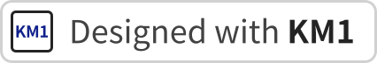

# アイコン / Icons

KM1-ICO-001。KM1 で使うアイコンの決まり。アイコンは **KM1 の名前で引く 1 つのセット**にし、Web・Flutter・Office・アプリアイコンで同じ絵柄を使う。
*KM1-ICO-001. One icon set addressed by KM1 names, shared across web, Flutter, Office and app icons.*

道具は `icons/` にある: 形を作る `km1_icons.py`、Flutter のアイコンフォントを作る `km1_font.py`、アプリアイコンを作る `km1_appicon.py`、検査 `iconcheck.py`。できあがったものは `icons/build/`（`km1-icons.json`・`sprite-20.svg`・`km1_icons.dart`。SVG 一式・フォント・Office 用の素材集・アプリアイコンは配布用の zip 1 つ `KM1_icons.zip` にまとめる。中は `icons/`・`office/`・`appicon/`）。
*Tools in `icons/`: `km1_icons.py` builds the shapes, `km1_font.py` the Flutter font, `km1_appicon.py` app icons, `iconcheck.py` checks. Outputs live in `icons/build/`; SVGs, font, Office pack and app icons ship together in one `KM1_icons.zip` (`icons/`, `office/`, `appicon/`).*

## 1. 中身 / What is in the set

- **全部のアイコンを KM1 B 案で描く（144 個）:** 「KM1 アイコン作成指示書」の B 案（調整版）を基準に、通常表示（Regular）も選択・強調の塗りの形（Filled）も KM1 が描いた。描き方は §8、塗りの形の決まりは §8.6。原図は `icons/km1_bdefs.py`。
  *Every icon (144) is drawn by KM1 in the B style, both Regular and Filled; rules in §8 and §8.6, drawings in `icons/km1_bdefs.py`.*
- **もとにした絵 / Source drawings:** KM1 のアイコンは、Fluent System Icons（MIT）の絵をもとに KM1 が描き直したもの。もとの絵の名前は `km1-icons.json` の `base` に、もとの形（20px）は `fluent` に、見比べるためだけに残す。画面には出さない（比べるときの `variant:'fluent'` だけ）。配布する zip に `LICENSE-Fluent.txt` を入れる。
  *KM1 icons are redrawn by KM1 from Fluent System Icons (MIT); the source name is kept in `base` and its 20px shape in `fluent`, for comparison only (`LICENSE-Fluent.txt`).*
- **Alert の状態の記号（4 個）も B 案:** `status-info`（丸に i）・`status-success`（丸にチェック）・`status-warning`（三角に !）・`status-error`（丸に !）。形で区別でき、色は状態の色（`info-ink` など）。Alert の中では塗りの形を使う。
  *Alert status symbols are B too, told apart by shape; Alert shows their Filled form in the status color.*
- **別名 / Aliases:** `calendar-empty`（空の予定）は `calendar`（予定）と同じ意味・同じ絵柄だったので、1 つにまとめた。古い名前は別名として当分残す（Web の `Icon` は `calendar` を出し、Flutter の `Km1Icons.calendarEmpty…` は非推奨）。「予定がない」ことは絵柄ではなく文言で伝える。
  *`calendar-empty` merged into `calendar` (same meaning and shape); the old name stays as a deprecated alias. Emptiness is said in words.*
- 部品やアプリは **KM1 の名前だけ**でアイコンを指定する。もとの絵の名前（`FluentIcons.*` など）を直接書かない。KM1 にない意味が要るときは、§8 の決まりで B 案を描き（塗りの形は §8.6 で自動で作る）、セットに足してから使う。同じ意味のアイコンを 2 つ作らない。
  *Products refer to icons only by KM1 name; new meanings get a B drawing (Filled is derived per §8.6). One meaning, one icon.*

## 2. 大きさと種類 / Sizes and styles

| 大きさ / Size | 使う場所 / Where | 形 / Drawing |
|---|---|---|
| 16px（`icon-sm`）| 表の中、小さなボタン、入力欄の中 | 16px 用の形 |
| 20px（`icon-md`）| 標準。ボタン・メニュー・一覧 | 基準の形 |
| 24px（`icon-lg`）| ナビゲーション、上部バー | 24px 用の形 |
| 32px（`icon-xl`）| 空の状態（`EmptyState`）だけ | 24px の形を拡大 |

線の太さは大きさごとに §8 の描き方の決まりで決める（この表は使う場所と表示の大きさだけ）。
*Stroke widths per size are defined only in the drawing rules (§8); this table lists where each size is used.*

- **Regular**（線）が標準。**Filled**（塗り）は選択中・強調だけに使う（ナビの選択中、お気に入りに入れた状態など）。1 つの画面で、同じ役目のアイコンの種類を混ぜない。
  *Regular by default; Filled only for selected or emphasized states.*
- 色は `currentColor`（文字の色に従う）1 色。アイコンだけに別の色を付けるのは状態の記号（`info-ink` など）だけ。
  *One color, `currentColor`; only status symbols take their status color.*
- 上の 4 つ以外の大きさに拡大・縮小しない。
  *No other sizes.*

## 3. 描き方 / How KM1 icons are drawn

描き方は §8（KM1 B 案）。足し方の手順: `icons/km1_bdefs.py` に B 案の原図を書き、もとの絵の名前を `km1_icons.py` の `IMPORT` に KM1 の名前で足す（塗りの形は原図から自動で作る）→ `python3 build_all.py`（形・フォント・Web・Flutter・Office・検査をまとめて作り直す）→ カタログで 16・20・24px を確かめる。
*Drawing rules are in §8. To add an icon: draw it in `km1_bdefs.py`, register its source drawing in `IMPORT` (Filled is derived), run `build_all.py`, then review 16/20/24px in the catalog.*

## 4. 一覧 / The set



全部で 144 個。通常表示も塗りの形も B 案。淡い面があるのは 63 個。別名 `calendar-empty` → `calendar`。2026-11-14 に足したもの: `task-list`・`notification-off`・`lock-open`・`timer`・`sparkle`・`view-month`・`text-size`・`filter-dismiss`（理由は §9）。
*144 icons, all B (Regular and Filled); 63 with the soft tint. Alias `calendar-empty` → `calendar`. Eight added on 2026-11-14 (see §9).*

| 名前 / Name | 日本語 | English | 面 / Tint | もとの絵 / Source drawing |
|---|---|---|---|---|
| `timetable` | 時間割 | Timetable | あり | `calendar_empty` |
| `add` | 追加 | Add | — | `add` |
| `subtract` | 減らす | Subtract | — | `subtract` |
| `dismiss` | 閉じる | Dismiss | — | `dismiss` |
| `check` | チェック | Check | — | `checkmark` |
| `chevron-down` | 下へ | Chevron down | — | `chevron_down` |
| `chevron-up` | 上へ | Chevron up | — | `chevron_up` |
| `chevron-left` | 前へ | Chevron left | — | `chevron_left` |
| `chevron-right` | 次へ | Chevron right | — | `chevron_right` |
| `arrow-up` | 上向きの矢印 | Arrow up | — | `arrow_up` |
| `arrow-down` | 下向きの矢印 | Arrow down | — | `arrow_down` |
| `arrow-left` | 戻る | Arrow left | — | `arrow_left` |
| `arrow-right` | 進む | Arrow right | — | `arrow_right` |
| `sort` | 並べ替え | Sort | — | `arrow_sort` |
| `sort-up` | 昇順 | Sort ascending | — | `arrow_sort_up` |
| `sort-down` | 降順 | Sort descending | — | `arrow_sort_down` |
| `edit` | 編集 | Edit | — | `edit` |
| `delete` | 削除 | Delete | — | `delete` |
| `copy` | 複製 | Copy | あり | `copy` |
| `search` | 検索 | Search | — | `search` |
| `filter` | 絞り込み | Filter | — | `filter` |
| `settings` | 設定 | Settings | — | `settings` |
| `more` | その他の操作 | More | — | `more_horizontal` |
| `more-vertical` | その他の操作（縦） | More (vertical) | — | `more_vertical` |
| `drag` | 並べ替えのつまみ | Drag handle | — | `re_order_dots_vertical` |
| `menu` | メニュー | Menu | — | `navigation` |
| `home` | ホーム | Home | あり | `home` |
| `open-external` | 別のタブで開く | Open externally | — | `open` |
| `link` | リンク | Link | — | `link` |
| `share` | 共有 | Share | — | `share` |
| `save` | 保存 | Save | あり | `save` |
| `download` | ダウンロード | Download | — | `arrow_download` |
| `upload` | アップロード | Upload | — | `arrow_upload` |
| `document` | 文書 | Document | あり | `document` |
| `folder` | フォルダー | Folder | あり | `folder` |
| `image` | 画像 | Image | あり | `image` |
| `tag` | タグ | Tag | あり | `tag` |
| `person` | 人 | Person | — | `person` |
| `people` | 人たち | People | — | `people` |
| `mail` | メール | Mail | あり | `mail` |
| `chat` | チャット | Chat | あり | `chat` |
| `notification` | 通知 | Notification | あり | `alert` |
| `star` | お気に入り | Favorite | — | `star` |
| `eye` | 表示 | Show | — | `eye` |
| `eye-off` | 非表示 | Hide | — | `eye_off` |
| `lock` | ロック | Locked | あり | `lock_closed` |
| `help` | ヘルプ | Help | — | `question_circle` |
| `warning` | 警告 | Warning | — | `warning` |
| `calendar` | 予定 | Calendar | あり | `calendar_ltr` |
| `clock` | 時刻 | Time | — | `clock` |
| `flag` | 旗 | Flag | あり | `flag` |
| `location` | 場所 | Location | あり | `location` |
| `offline` | オフライン | Offline | あり | `cloud_off` |
| `sync` | 同期 | Sync | — | `arrow_sync` |
| `undo` | 元に戻す | Undo | — | `arrow_undo` |
| `history` | 履歴 | History | — | `history` |
| `print` | 印刷 | Print | あり | `print` |
| `pin` | ピン留め | Pin | — | `pin` |
| `briefcase` | 仕事 | Work | あり | `briefcase` |
| `deadline` | 締め切り | Deadline | あり | `calendar_clock` |
| `due-today` | 今日が期限 | Due today | あり | `calendar_error` |
| `tentative` | 仮の予定 | Tentative | あり | `calendar_question_mark` |
| `canceled` | 休講・中止 | Canceled | あり | `calendar_cancel` |
| `repeat-weekly` | 毎週くり返す | Repeats weekly | あり | `calendar_arrow_repeat_all` |
| `view-day` | 日の表示 | Day view | あり | `calendar_day` |
| `view-week` | 週の表示 | Week view | あり | `calendar_work_week` |
| `view-agenda` | 予定の一覧 | Agenda view | あり | `calendar_agenda` |
| `shift-work` | 勤務・バイト | Shift work | あり | `shifts` |
| `room-change` | 教室の変更 | Room change | あり | `door_arrow_right` |
| `submit` | 提出 | Submit | あり | `document_arrow_up` |
| `exam` | 試験 | Exam | あり | `clipboard_task` |
| `status-info` | お知らせ | Information | — | `info` |
| `status-success` | 完了 | Success | — | `checkmark_circle` |
| `status-warning` | 注意 | Warning | — | `warning` |
| `status-error` | エラー | Error | — | `error_circle` |
| `density-compact` | 密度: 詰める | Density: compact | — | `line_horizontal_5` |
| `density-regular` | 密度: 標準 | Density: regular | — | `line_horizontal_4` |
| `density-spacious` | 密度: ゆったり | Density: spacious | — | `line_horizontal_3` |
| `cart` | カート | Cart | あり | `cart` |
| `receipt` | レシート | Receipt | あり | `receipt` |
| `store` | 店 | Store | あり | `building_shop` |
| `product` | 商品 | Product | あり | `box` |
| `discount` | 割引 | Discount | あり | `tag_percent` |
| `money` | お金 | Money | あり | `money` |
| `wallet` | 財布 | Wallet | あり | `wallet` |
| `payment-card` | カード払い | Card payment | あり | `payment` |
| `qr-code` | QR コード | QR code | — | `qr_code` |
| `ticket` | 整理券 | Ticket | あり | `ticket_diagonal` |
| `waiting` | 待ち | Waiting | — | `hourglass_half` |
| `calculator` | 電卓 | Calculator | あり | `calculator` |
| `barcode-scan` | バーコードを読む | Scan barcode | — | `barcode_scanner` |
| `calendar-add` | 予定を追加 | Add event | あり | `calendar_add` |
| `reminder` | リマインダー | Reminder | — | `clock_alarm` |
| `note` | メモ | Note | あり | `note` |
| `attach` | 添付 | Attach | — | `attach` |
| `send` | 送信 | Send | あり | `send` |
| `phone` | 電話 | Phone | — | `call` |
| `globe` | Web・言語 | Globe | — | `globe` |
| `camera` | カメラ | Camera | あり | `camera` |
| `person-add` | 人を追加 | Add person | — | `person_add` |
| `sign-out` | ログアウト | Sign out | — | `sign_out` |
| `sign-in` | ログイン | Sign in | — | `arrow_enter` |
| `refresh` | 再読み込み | Refresh | — | `arrow_clockwise` |
| `list` | リスト | List | — | `list` |
| `grid` | グリッド | Grid | — | `grid` |
| `table` | 表 | Table | — | `table` |
| `chart` | グラフ | Chart | — | `data_bar_vertical` |
| `bookmark` | しおり | Bookmark | あり | `bookmark` |
| `heart` | いいね | Like | — | `heart` |
| `cloud` | クラウド | Cloud | あり | `cloud` |
| `wifi` | Wi-Fi | Wi-Fi | — | `wifi_1` |
| `light-mode` | ライト | Light mode | — | `weather_sunny` |
| `dark-mode` | ダーク | Dark mode | — | `weather_moon` |
| `keyboard` | キーボード | Keyboard | あり | `keyboard` |
| `zoom-in` | 拡大 | Zoom in | — | `zoom_in` |
| `zoom-out` | 縮小 | Zoom out | — | `zoom_out` |
| `expand` | 広げる | Expand | — | `arrow_maximize` |
| `collapse` | 縮める | Collapse | — | `arrow_minimize` |
| `play` | 再生 | Play | — | `play` |
| `pause` | 一時停止 | Pause | — | `pause` |
| `mic` | マイク | Microphone | あり | `mic` |
| `volume` | 音量 | Volume | あり | `speaker_2` |
| `map` | 地図 | Map | あり | `map` |
| `building` | 建物 | Building | あり | `building` |
| `school` | 学校 | School | あり | `hat_graduation` |
| `book` | 本 | Book | あり | `book` |
| `redo` | やり直す | Redo | — | `arrow_redo` |
| `paste` | 貼り付け | Paste | あり | `clipboard_paste` |
| `select-all` | すべて選択 | Select all | — | `select_all_on` |
| `key` | 鍵・パスワード | Key | — | `key` |
| `shield` | 保護 | Shield | あり | `shield` |
| `folder-open` | 開いたフォルダー | Open folder | あり | `folder_open` |
| `archive` | アーカイブ | Archive | あり | `archive` |
| `contact-card` | 連絡先 | Contact | あり | `contact_card` |
| `bus` | 交通 | Transit | あり | `vehicle_bus` |
| `weather` | 天気 | Weather | あり | `weather_partly_cloudy_day` |
| `task-list` | タスク | Tasks | — | `task_list_ltr` |
| `notification-off` | 通知オフ | Notifications off | あり | `alert_off` |
| `lock-open` | ロック解除 | Unlocked | あり | `lock_open` |
| `timer` | タイマー | Timer | — | `timer` |
| `sparkle` | 自動処理 | Automatic | — | `sparkle` |
| `view-month` | 月の表示 | Month view | あり | `calendar_month` |
| `text-size` | 文字の大きさ | Text size | — | `text_font_size` |
| `filter-dismiss` | 絞り込みを解除 | Clear filters | — | `filter_dismiss` |

## 5. 使い方 / Using the icons

| 環境 / Platform | 使い方 / How |
|---|---|
| Web（React）| `h(Icon,{name:'deadline'})`。大きさは `size`（16・20・24・32）、塗りは `filled`。名前の一覧は `ICONS` |
| Web（React 以外）| `icons/build/sprite-20.svg` の `<symbol>`（`#km1-deadline-regular`）か、`km1-icons.json` のパス |
| Flutter | **標準は `Km1BIcon(Km1BIconName.deadline)`**（B 案の形）。大きさは `size`（16・20・24、32 は 24 の形を拡大）、選択・強調は `filled: true`（B 案の塗りの形）、部品の中では `inherit: true` でまわりの色に従う、状態の色は `color`。ファイルは `km1_icons_b.dart` と、字形の `km1_icons.dart`＋`KM1Icons.ttf`（pubspec の `fonts` に `family: KM1Icons`）。組み込みに要るのはこの 3 つと `km1_theme.dart`（色の定義。同じ版のもの）だけで、`km1_widgets.dart` は要らない（色は `Theme.of(context).extension<Km1Colors>()` から直接読み、なければ `Km1Colors.light`）。`Icon(Km1Icons.deadline)` もフォントの字形として B 案の形が出るが、1 色で淡い面がない。通常表示は `Km1BIcon` を使い、字形は文字と並べるときや `Km1Icons.deadlineFilled` で塗りの形を直接出すときに使う|
| PowerPoint・Word | Office 用の素材集の SVG（「挿入 › 画像」）。色は「グラフィックの塗りつぶし」で変えられる。PNG もある（256px）|
| Windows・iOS・Android のネイティブ | SVG を各環境の画像として取り込む（iOS は Asset Catalog で「Preserve Vector Data」、Android は Vector Asset）|

- 意味を持つアイコンには読み上げの名前を付ける（Web は `label`、Flutter は `semanticLabel`）。文字の横に置く飾りのアイコンには付けない（同じことを 2 度読ませない）。
  *Give meaningful standalone icons a label; decorative icons next to text get none.*
- 操作のアイコンには文言を添える。アイコンだけにしてよいのは、閉じる・検索・戻るなど意味が定着したものだけで、その場合も `aria-label`（Flutter は `semanticLabel`）とツールチップを付ける。
  *Action icons carry a label; icon-only only for settled meanings (close, search, back), with `aria-label`/`semanticLabel` and a tooltip.*
- KM1 のアイコンにないアイコン集（Material Icons など）は混ぜない。足りないときは KM1 のアイコンに足す（§3 の手順）。Flutter でも `Icons.*` は使わない。
  *Never mix in other icon sets; add missing icons to KM1 (§3). No `Icons.*` in Flutter.*
- 1 つの意味に 1 つのアイコンを割り当て、画面が変わっても変えない。意味が曖昧になるなら、アイコンをやめて文言だけにする。
  *One meaning, one icon, on every screen; if the meaning turns vague, drop the icon and use words.*

## 6. アプリアイコン・ファビコン / App icons and favicons

**KM1 のしるし / The KM1 mark:** 紺（`brand` #10218B）の正方形に、白の「KM1」と表紙のしるし（22:6 の帯）。文字は Noto Sans CJK JP Bold の字形を輪郭にしたもの（SIL OFL 1.1。輪郭にしたロゴに使ってよい）。48px より小さいファビコンは帯を省き、文字を大きくする。
*Navy square with a white "KM1" wordmark and the cover bar; favicons under 48px drop the bar and enlarge the text.*

**作り方の決まり（どのアプリにも使う）/ Rules for any app**

| 項目 / Item | 決まり / Rule |
|---|---|
| 元の絵 / Master | 1024 × 1024px の正方形。背景を全面に塗る（角は OS が丸める）|
| 絵柄の範囲 / Safe area | 中央の直径 60% の円に収める（絵柄を囲む長方形の対角線を 60% 以下、幅は 56% まで）。Android のアダプティブアイコンで欠けない円（108dp のうち 66dp、61%）と、PWA の maskable の安全な円（80%）の両方に入る |
| 小さいとき / Small | 48px 以下のファビコンは絵柄を 80% に広げ、角を 20% 丸めて書き出す（ブラウザは丸めない）|
| 色 / Colors | 背景は KM1 の色（`brand` か分類色）、絵柄は白か `ink`。絵柄と背景は 3:1 以上（`km1_appicon.py` が確かめ、足りなければ作らない）|
| 絵柄 / Motif | KM1 のしるし、KM1 のアイコンの Filled 1 つ、または 3 文字までの文字。写真・細かい絵・文章は使わない |
| 透明 / Transparency | iOS・macOS とストア用は透明を使わない。Android の前面の層と monochrome の層だけ透明 |

**書き出すもの / Outputs:** `web/`（favicon.ico 16・32・48、favicon.svg、apple-touch-icon 180、192・512、maskable 512、`head.html`、`manifest-icons.json`）、`android/`（アダプティブの前面・背面・monochrome 432px、ストア 512）、`ios/`（AppIcon 1024、透明なし）、`windows/`（44・150・310）、`flutter_launcher_icons.yaml`。
*Writes web, Android adaptive, iOS, Windows sizes plus config snippets.*

**ほかのアプリに当てはめる / Applying to another app:** 背景の色と絵柄を変えて同じ道具を使う。例: `python3 km1_appicon.py out/schedule --bg 038387 --icon timetable --icons build/km1-icons.json --name 予定`（ティールに時間割のアイコン）。Flutter のアプリは、できた `flutter_launcher_icons.yaml` で各 OS に入れる。
*Same tool, different colour and motif; Flutter apps use the generated `flutter_launcher_icons.yaml`.*

## 7. 検査 / Checking

`iconcheck.py` が調べる: 全部のアイコンに 16・20・24px の Regular と Filled があること、パスが空でないこと、枠（viewBox）からはみ出さないこと、B 案の形が 20 の格子で余白 1 に収まり、もとにした Fluent の絵の名前があること、Regular と Filled が同じ形でないこと（注意）、名前の形、日本語と英語の名前、取り込んだものの出典の表示、拡大・縮小で補った大きさ（注意）、Flutter のフォントに全部のアイコンが入っていること。FAIL があると終了コード 1。
*`iconcheck.py` checks completeness, bounds, the live area, names, labels, sources and the Flutter font.*

**人の目の検査 / Human checks**

- [ ] 16px で細部が潰れていない / details survive at 16px
- [ ] Regular と Filled を並べて、同じ絵に見える（塗りで別の絵にならない）/ Regular and Filled read as the same picture
- [ ] 意味が文言なしでも伝わるか、伝わらないなら文言を添えている / meaning is clear, or a label is added
- [ ] アプリアイコンを実際のホーム画面（丸・角丸・しずく形）で見て、絵柄が欠けない / app icon survives each mask shape

## 8. KM1 B 案（調整版）の描き方 / Drawing KM1 B icons

通常表示（Regular）は、「KM1 アイコン作成指示書」の B 案（調整版）を基準に描く。検索・予定・フォルダ・削除・警告・通知の 6 種は付録の原図どおり、残りはその決まりで KM1 が描いた（2026-11-13）。選択・強調（Filled）も同じ原図から作る（§8.6、2026-11-14）。
*Regular icons follow the B (adjusted) sheet: the six from its appendix as drawn, the rest drawn by KM1 to the same rules. Filled is derived from the same drawings (§8.6).*

**描くときの決まり / Drawing rules**

- 淡い面は、閉じた「もの」の形にだけ付ける: 予定の仲間・書類（文書・提出・試験・複製）・入れ物（フォルダ・かばん・メール・吹き出し・画像・タグ・保存・印刷）・建物と鍵・旗と場所・通知・勤務・教室の変更・オフラインの雲。操作の記号（矢印・×・＋・チェック・並べ替えなど）、円の記号（時刻・ヘルプ・履歴）、人、目、星には付けない。
  *Tint only on closed objects; never on action marks, circle symbols, people, eyes or stars.*
- 予定の仲間は予定の枠（原図の `calendar`）の中、見出しの線より下に記号を置く（時刻・！・？・×・くり返し・行・列）。右下の丸い印（もとの絵のバッジ）は使わない。
  *Calendar variants place their mark inside the body, not in a corner badge.*
- 斜線で打ち消す形（オフライン・非表示・通知オフ）は、斜線の両側を線の幅の 2.4 倍くり抜いてから斜線を描く。
  *Slashed icons knock out 2.4× the stroke width around the slash.*
- 点（…・つまみ・！の点）は 20px で半径 0.85〜1.15、16px は 0.15 大きくする。
  *Dots: r 0.85–1.15 at 20px, +0.15 at 16px.*
- 線は描いたあと大きさごとに輪郭にし（`km1_bdefs.py`）、Web も Flutter も同じ輪郭を塗る。
  *Strokes are outlined per size and filled identically on web and Flutter.*

| 項目 / Item | 決まり / Rule |
|---|---|
| 格子 / Grid | `viewBox="0 0 20 20"`。16・24px も同じ原図を拡大・縮小し、線の幅だけ大きさごとに直す |
| 線 / Stroke | 線の太さはここだけで決める（1 章の表には書かない）。20px で 1.45（検索は 1.35）。16px は 1.625（実寸 約 1.3px、検索 1.5）、24px は 1.3（実寸 約 1.55px、検索 1.2）。端と角は丸める |
| 色 / Color | 線と記号は `currentColor`。通常表示では `icon-ink`（ライト #657283・ダーク #9AA7B8）を当てる |
| 淡い面 / Tint | 閉じた「もの」の形のうち、面があると形が分かりやすくなるものだけ（いま 63 個: 予定の仲間・書類・入れ物・建物・乗り物・機器など。一覧は §4 の「面」の列）。矢印・×・＋などの操作の記号、円の記号、人、目、星には付けない。閉じた面の内側に、上 `icon-tint-start`（#F6F8FB／ダーク #3B4452）から下 `icon-tint-end`（#D3DCE7／ダーク #2A313B）への縦のグラデーション |
| 状態 / States | ホバー・押下・押した・選んだ・今いる場所・無効では、線は親の文字色に従う。押した・選んだ・今いる場所では塗りの形（Filled、§8.6）に替える。主ボタンなど強い背景の上では面を描かない |
| 強制カラー / Forced colors | 面を描かず、線は文字色。輪郭だけで区別できる |
| コントラスト / Contrast | `icon-ink` と背景（ライト 4.90:1・ダーク 5.95:1）、`icon-ink` と面の下端（ライト 3.54:1・ダーク 5.37:1）はどちらも 3:1 以上。`iconcheck.py` が確かめる |
| 光学調整 / Optical | 16px の通知は振り子を小さく下げて、本体の線とつながらないようにした（`ink16`）。点は 16px で半径を 0.15 大きく |
| グラデーションの ID | Web はアイコンごとに一意の ID（`Icon` が付ける）。配布用の SVG は 1 ファイルに 1 つなので名前つきの ID、スプライトは定義を共有 |
| 元に戻す / Revert | 比べるときは `variant:'fluent'`、アプリ全体で戻すときは `setIconStyle('fluent')`。どちらももとの絵の形（20px の形を拡大・縮小）を出す。Web だけ |

**環境ごとの対応 / Platforms:** Web（`Icon`。Flutter の部品（`km1_widgets.dart`）の中のアイコンも `Km1BIcon` に切り替え済みで、部品の中では `inherit: true` で IconTheme の色に従う。部品の中のアイコン `icon16`・`icon20` も B 案で描き、色は部品の文字色に従う）、Flutter（`Km1BIcon`、`icons/km1_icons_b.dart`。原図の SVG のパスを Dart の描画命令に直して作るので同じ形）、配布用の SVG と Office の素材（Office の SVG は #657283 と面の色を直接書き込み）。Flutter のアイコンフォントの `Km1Icons.search` なども B 案の形（1 色。フォントは淡い面を持てない）。
*Web `Icon` (also inside parts using `icon16`/`icon20`), Flutter `Km1BIcon` generated from the same path data, and SVG/Office files. Flutter font glyphs are B shapes too, in one color without the tint.*

### 8.6 塗りの形（Filled）/ The Filled form

塗りの形は、通常表示と同じ原図から `km1_bdefs.outline_filled` が作る。人が別に描かない。
*Filled is derived from the same drawing by `km1_bdefs.outline_filled`; nobody draws it separately.*

| 決まり / Rule | 中身 / What |
|---|---|
| 閉じた形を塗る | 閉じた線の輪郭（予定の枠・文書・丸・星など）と、淡い面の形と、`solid` で指定した場所（人の体・ごみ箱の本体）を中まで塗る。検索の虫めがね（`hollow`）は輪のまま |
| 中の記号はくり抜く | ほかの閉じた形の中に収まる線と点（予定の見出しの線・時計の針・チェック・！など）は、通常表示と同じ太さでくり抜いて白く見せる。中にある丸は輪だけくり抜き、中身は塗ったまま |
| 外の線は太く | 閉じた形の外に出る線と、操作の記号（矢印・×・＋・山かっこ）は 1.2 倍の太さ、外の点は 1.2 倍の大きさで塗る |
| 斜線 | 斜線で打ち消す形（オフライン・非表示・通知オフ）は、通常表示と同じく両側をくり抜いてから斜線を描く |
| 色 | 1 色（`currentColor`）。淡い面は描かない。押した・選んだ・今いる場所では、まわりの文字色（多くはブランド色）に従う |

**もとの絵の塗りの形を使わない理由 / Why not the source Filled:** B 案の通常表示ともとの絵の塗りの形を並べて比べたところ（2026-11-14、136 個）、別の絵になるものが多かった。例: 並べ替え（上・下）は塗りでは矢印 1 本になり意味が変わる、待ち（砂時計）は砂だけの形、ログアウトは扉、整理券は斜め、密度の線の本数が違う、元に戻す・やり直すの矢印の形が違う、目は半分の形。選んだときに絵が変わると、同じものだと分かりにくいので、同じ原図から作ることにした。
*Comparing the B Regular with the source Filled for all 136 icons showed many different pictures (sort up/down became a single arrow, hourglass, sign-out door, ticket angle, density line counts, undo/redo, half eye). A picture that changes when selected is hard to recognise, so Filled is now derived from the same drawing.*

## 9. 足した・足さなかったアイコン / Icons added and not added

KM1 を使うアプリ（スケジュール確認、イベント向け POS、作業の手助け）、KM1 の部品と文書、Web の部品の中のアイコンを見て、足りない意味を探した。
*Looked at the apps that use KM1 (schedule check, event POS, task helper), the components and docs, and icons drawn inside components.*

| 足したもの / Added | 理由 / Why |
|---|---|
| `task-list`（タスク） | 締め切り・タスクの管理（スケジュール確認）と、作業の手助けのタスク一覧。`exam`（試験）や `select-all` では意味が違う |
| `notification-off`（通知オフ） | 通知を止める設定。`notification` に斜線（オフライン・非表示と同じ決まり） |
| `lock-open`（ロック解除） | POS の開設・締めなど、鍵を開けた状態。`lock` と組で使う |
| `timer`（タイマー） | 「5 分だけ始める」などの時間を計る操作。`clock`（時刻）・`waiting`（待ち）・`reminder`（知らせ）とは別の意味 |
| `sparkle`（自動処理） | メールなどの文章を読み取って予定に入れる、自動で入れたものの印。自動で処理したことを示すときは文言も添える |
| `view-month`（月の表示） | カレンダーの月の表示の切り替え。日・週・予定表はあったが月がなかった |
| `text-size`（文字の大きさ） | 文字の大きさの設定（アクセシビリティ）。KM1 は文字の拡大に対応するので、設定の入口が要る |
| `filter-dismiss`（絞り込みを解除） | 空の状態（`EmptyState`）と表で「絞り込みを解除」する操作 |

| 足さなかったもの / Not added | 理由 / Why |
|---|---|
| 情報（丸に i） | `status-info` と同じ意味。文の中で補足を示すときも `status-info` を使う |
| 言語 | `globe`（Web・言語）がある |
| 書き出し・取り込み | `download`・`upload`・`share`・`paste` で足りる |
| 点数・計器（作業の手助けの危険度） | 数値と文言で示す。アイコンだけで量は伝わらない |
| 会社・サービスのロゴ（Google など） | 他者の商標は各社の決まりの形を画像で使う（「基礎」の書体と同じ扱い） |

**部品の中の直し:** Alert の「閉じる」ボタンだけ、アイコンのセットを使わずに × を直接描いていた。`dismiss` に直した。
*The Alert close button drew its own ×; it now uses `dismiss`.*


## 10. ロゴと表示 / Logo and attribution

KM1 のロゴは、§6 のしるしと同じ形（「KM1」と表紙の帯）を、色を入れ替えて**白地に青**にしたもの。白い面が明るい背景に溶けないよう、黒（`ink`）の細い縁で囲む。形は足さない。アプリアイコン（§6）は紺地に白のまま。KM1 で作ったものに付ける表示（バッジ）もここで決める。道具は `brand/km1_logo.py`、できあがりは `dist/logo/`（SVG と PNG の 1・2・3 倍）。
*The KM1 logo is the §6 mark with colours swapped — blue on white, framed by a thin ink hairline; the app icon (§6) stays white on navy. This section also defines the attribution badge for things made with KM1. Tool: `brand/km1_logo.py`; output: `dist/logo/` (SVG and PNG @1x/2x/3x).*




**形 / Parts**

| 種類 / Kind | 中身 / Contents | ファイル / Files |
|---|---|---|
| しるし / Mark | §6 と同じ形を白地に青で。ロゴは OS に切り抜かれないので、中身はアプリアイコン（直径 60% の円）より大きく、「KM1」の幅をしるしの 84% にする。小さく置かれても潰れないよう、24px 未満では字形を Black（極太）に替える。縁は `ink`（#242424）の細い線で、太さはしるしの 1/64（64px 以下は 1px）。角は 32px のときの `radius-md`（4px）と同じ比（12.5%）。48px 未満は帯を省く | `km1-mark(-dark/-mono).svg` |
| 横組み / Logo | しるし＋間（しるしの 1/4）＋「KM1」。「KM1」の大文字の高さはしるしの 0.42。文字は `ink` | `km1-logo(-dark/-mono).svg` |
| 表示バッジ / Badge | 高さ 24px、縁 1px（`stroke`）、角 `radius-md`、しるし 20px、文字 12px（`caption-1`）。「Designed with」は `ink-secondary`、「KM1」は太字の `ink` | `designed-with-km1(-dark).svg`、`km1-de-sekkei(-dark).svg` |

文字は Noto Sans CJK JP の字形を輪郭にしてある（SIL OFL 1.1）。書体を読み込まなくても同じ形で出る。
*Text is outlined from Noto Sans CJK JP (SIL OFL 1.1), so it renders the same without the font.*

**色 / Colors**

| 版 / Version | しるし / Mark | 文字 / Text | 使う場所 / Use on |
|---|---|---|---|
| ライト / light | 白地に `brand`（#10218B）の文字と帯、`ink` の細い縁 | `ink`（#242424） | `surface` などの明るい面 |
| ダーク / dark | ライトと同じ（暗い面の上でも色を変えない） | 白 | ダークの `surface`（#292929）などの暗い面 |
| 単色 / mono | 縁・文字・帯を `ink` 1 色。地は透明 | `ink` | 1 色で刷るもの、写真の上など色が決められない場所 |

**表示の文言 / Wording:** 「**Designed with KM1**」（日本語の画面では「**KM1 で設計**」）にする。KM1 はデザインの標準なので「with（KM1 を使って設計した）」。「Designed by」は KM1 がその製品を設計したと読めるので使わない。「Powered by」は動かす仕組み（サーバー・エンジン）を指す言い方で、KM1 にはそれがないので使わない。
*Use "Designed with KM1" ("KM1 で設計" in Japanese UI). KM1 is a design standard, so "with". Not "Designed by" (reads as KM1 designing the product) and not "Powered by" (implies a runtime; KM1 has none).*

**付けてよいもの / When to show it**

- KM1 の決まり（トークン・部品・文言）に従って作ったアプリ・ページ・文書。一部だけ（色だけなど）なら付けない。
  *Apps, pages and documents that follow KM1's tokens, components and wording; not ones that borrow only part (e.g. colours).*
- 付けるかどうかは任意。付けなくても KM1 のライセンス（MIT）の条件には関係しない。
  *Optional; unrelated to KM1's MIT licence terms.*

**置き場所 / Placement**

- Web のページはフッター、アプリは「このアプリについて」や設定の最後、文書・スライドは最後のページ（奥付）。上の帯・最初の画面・主な操作の近くには置かない。
  *Web: footer. Apps: About or the end of Settings. Documents and slides: the last page. Never in the top bar, the first screen or near primary actions.*
- 製品自身のロゴより大きくしない。リンクにするときは GitHub の正本（`https://github.com/kami2news/km1-design-system`）へ。
  *Never larger than the product's own logo; link to the GitHub repository.*

**大きさと余白 / Size and clear space**

| 種類 / Kind | いちばん小さい大きさ / Minimum | まわりの余白 / Clear space |
|---|---|---|
| しるし / Mark | 20px（48px 未満は帯なし、24px 未満は極太の版）。16px は SVG か 2 倍以上の画像のときだけ | しるしの 1/4 |
| 横組み / Logo | 高さ 24px | しるしの 1/4 |
| 表示バッジ / Badge | 高さ 24px（拡大は 32px まで） | 8px（`space-sm`） |

**してはいけないこと / Don'ts:** 色を変える、縦横の比を変える、傾ける、影・ぼかし・グラデーションを付ける、文字を打ち直す（書体が変わる）、文言を変える、ほかのロゴとくっつける、KM1 に従っていないものに付ける。
*Do not recolour, stretch, rotate, add shadows/blur/gradients, retype or reword it, attach it to another logo, or put it on things that do not follow KM1.*

**使い方の例 / Usage**

Web（ライトとダークを OS の設定で切り替える）:

```html
<a href="https://github.com/kami2news/km1-design-system">
  <picture>
    <source srcset="designed-with-km1-dark.svg" media="(prefers-color-scheme: dark)">
    
  </picture>
</a>
```

Flutter は `designed-with-km1.png`（と `@2x`・`@3x`）を assets に入れ、`Image.asset` で高さ 24 にして出す。読み上げ用に `semanticLabel: 'Designed with KM1'` を付ける。PowerPoint は `KM1_表示バッジ.pptx` からコピーして貼る（GitHub へのリンクと代替テキストが付いている。置き場所は `office.md` §4.5）。Word は PNG の 3 倍を高さ 24px（6.35 mm）で貼り、「挿入 › リンク」で GitHub の URL を付ける。
*Flutter: ship the PNGs as assets and show at height 24 with `semanticLabel`. PowerPoint: copy from `KM1_表示バッジ.pptx` (linked, with alt text). Word: paste the @3x PNG at 24px (6.35 mm) and add the GitHub link.*

KM1 は個人の標準なので、このロゴはどの企業・団体の承認も示さない（`notices.md`）。
*KM1 is a personal standard; the logo implies no endorsement by any company or organization (`notices.md`).*

出典 / Sources: 「参考文献」（`references.md`）の 1・4 節。
