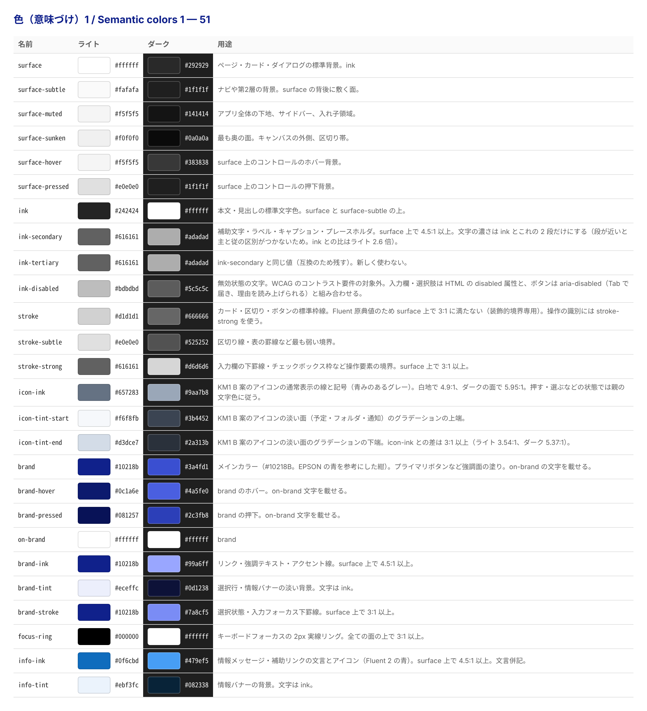
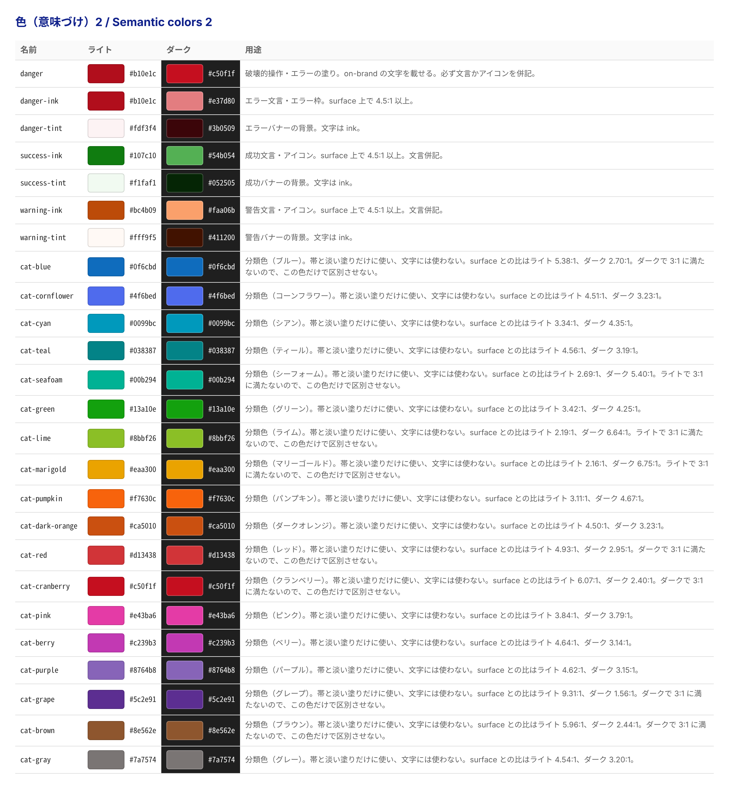
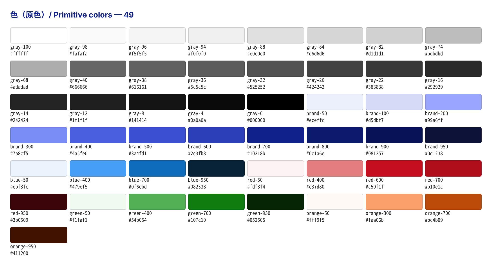
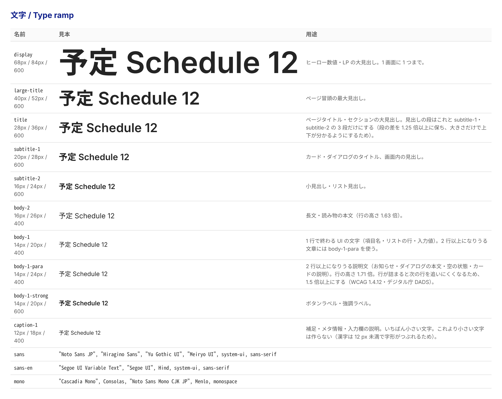
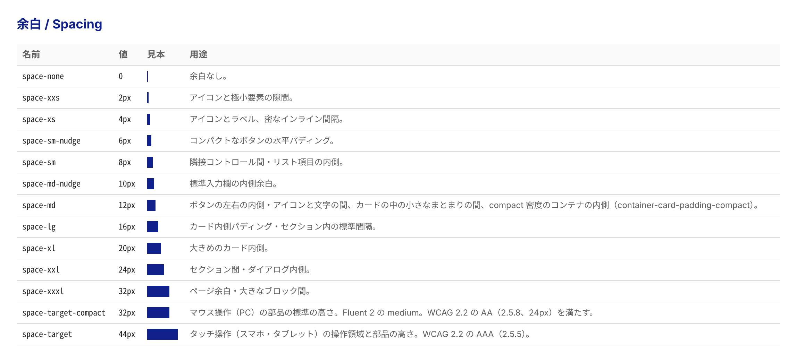
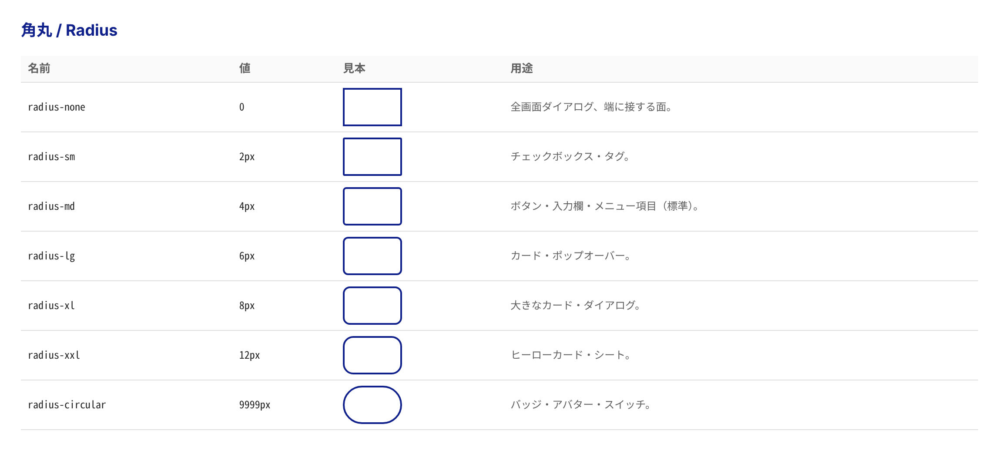
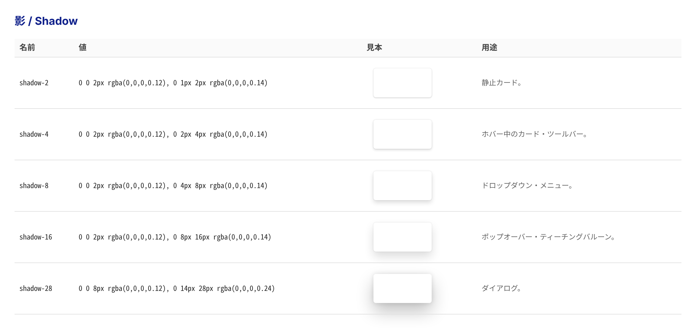
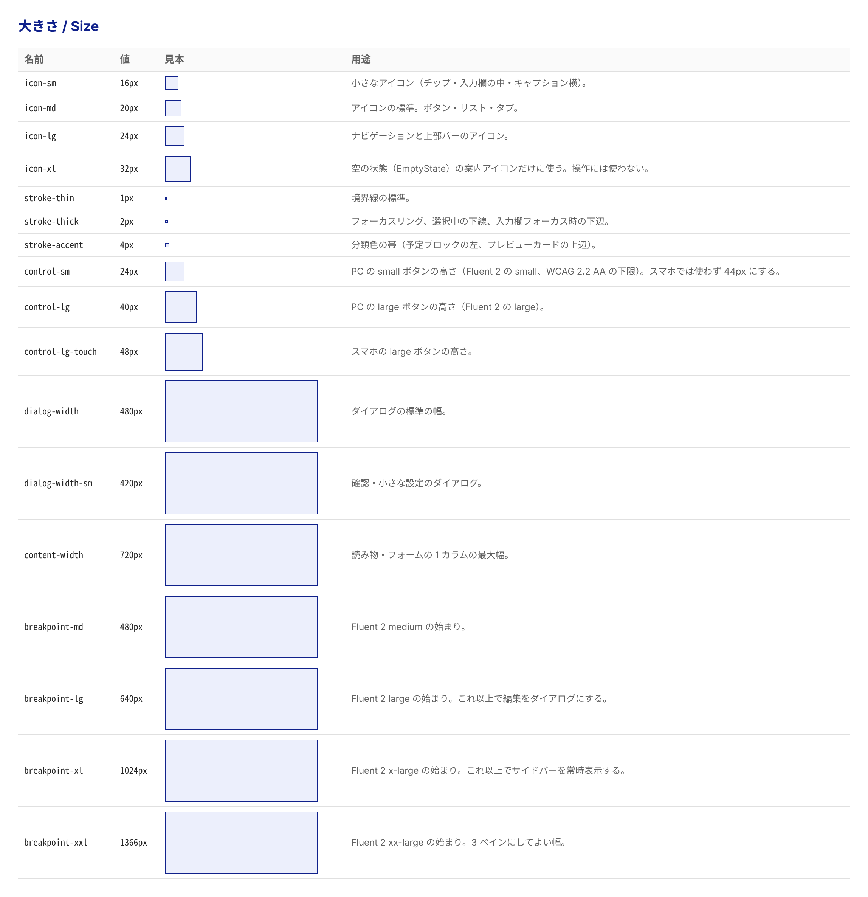

# 基礎 / Foundations

色・文字・余白・角丸・影・線・状態・密度・操作領域・書体の決まり（KM1-TOK-001）。値そのものは `tokens.json` が正で、各 OS 向けのファイルはそこから生成する。値は Fluent 2 のトークンから始め、KM1 の軸に合わせて変えてきた（「原則」の「土台と味付け」）。
*Colour, type, spacing, radius, shadow, stroke, states, density, hit areas and typefaces (KM1-TOK-001). `tokens.json` is the source; platform files are generated from it. Values started from Fluent 2 tokens and have been adjusted to KM1's axes.*

## 1. トークンの仕組み / How tokens work

色は「原色」（`gray-*`、`brand-*`、`blue-*`、`red-*`、`green-*`、`orange-*`）と「意味づけ」（`surface`、`ink`、`brand` など）の二層。UI と実装は意味づけトークンだけを参照し、原色を直接使わない。ライトとダークの違いは、意味づけトークンが指す原色の違いだけで表す。
*Color has two layers: primitives (`gray-*`, `brand-*`, `blue-*`, `red-*`, `green-*`, `orange-*`) and semantic tokens (`surface`, `ink`, `brand`, ...). UI and code reference semantic tokens only. Light and dark differ only in which primitive a semantic token points to.*

| 段 / Tier | KM1 での例 / In KM1 | 使い方 / Use |
|---|---|---|
| 基本（primitive）| 色 `gray-14`・`brand-700`、余白 `space-*`、角丸 `radius-*`、寸法 `size` の族 | 部品のコードからは直接使わず、意味づけ・用途別のトークンを通して使う（余白は従来どおり `space-*` を直接使ってよい） |
| 意味づけ・用途別（semantic）| 色 `surface`・`ink`・`brand`、余白の用途 `layout-section-gap`・`container-card-padding-*`・`collection-item-gap-*`、操作領域 `control-target-*` | まず探すのはここ。新しい部品も、ここにある用途で足りるかを先に確かめる |
| 部品専用（component）| 今は作っていない | 部品の構造が特殊で、意味づけ・用途別のトークンでは表せないときだけ作る |

部品専用のトークンを最小限にするのは、部品ごとに値を持たせると、同じ意味の値が部品によってずれる（ムラ）ため。
*Component tokens stay minimal because per-component values drift apart (inconsistency).*

**名前の読み方 / Reading names:** 左から、どこに → 何に → どの選択肢。`container-card-padding-compact` は「コンテナの、Card の、内側の余白の、compact」。
*Names read left to right: where → what → which option.*

## 2. 色 / Color

- **色 / Color**: 面は `surface` を基準に `surface-subtle` → `surface-muted` → `surface-sunken` と奥へ。文字の濃さは `ink` と `ink-secondary`（#616161）の 2 段だけ（段が近いと主と従の区別がつかないため。`ink-tertiary` は互換のため同じ値で残す）。メインカラーは紺の `#10218B`（`brand`＝塗り、`brand-stroke`＝縁・下線、`brand-ink`＝文字・リンク）で、1 画面でプライマリボタンは 1 つ。ブランド塗りの上は `on-brand`。情報は `info-*`、ステータスは `danger` / `success-ink` / `warning-ink` と各 `-tint`。
  *Surfaces step back from `surface` to `surface-sunken`. Text uses two weights only, `ink` and `ink-secondary` (#616161), so primary and secondary stay distinct (`ink-tertiary` remains as an alias). The main color is the navy `#10218B` (`brand` fills, `brand-stroke` edges and underlines, `brand-ink` text and links); one primary button per screen; `on-brand` on brand fills. Info uses `info-*`; status uses `danger`, `success-ink`, `warning-ink` with `-tint` backgrounds.*
- **境界線 / Borders**: 装飾は `stroke` / `stroke-subtle`、操作できる要素は `stroke-strong`。`stroke` は surface の上で 3:1 に満たないため、操作の識別には使わない。
  *Decorative borders use `stroke` / `stroke-subtle`; interactive elements use `stroke-strong`. `stroke` falls below 3:1 on surfaces, so never use it alone to identify a control.*
- **選択時の縁 / Selected edges**: チェック・ラジオ・スイッチ・タブの選択表示の縁と下線は、塗り（`brand`）ではなく `brand-stroke` を使う。ダークでも背景に対して 3:1 以上を保つため。
  *Edges and underlines that show selection (checkbox, radio, switch, tab) use `brand-stroke`, not the `brand` fill, so they keep 3:1 against the background in dark too.*
- **分類色 / Category colors**: `cat-*` の 18 色は、利用者が付ける分類のためだけの色。帯と淡い塗りにだけ使う。使い方は「画面の組み立て」セクション。
  *The 18 `cat-*` colors are only for user-assigned categories, as bars and tinted fills. See the Patterns section.*
- **色 × 模様 / Color × pattern** (KM1-COL-001): 分類は 18 色 × 8 模様の 144 通りで区別する。模様は文字の下に描かず、しるし・凡例・グラフの塗りだけに使う（`CategoryMark`・`CategoryLegend`）。
  *Categories use 18 colors × 8 patterns; patterns appear only in marks, legends and chart fills.*
- **ダークの淡い面 / Dark tints**: `brand`・`info`・`danger`・`success`・`warning` の `*-tint` は、ダークでは暗い面（#1F1F1F）にその色を 16% 混ぜた彩度の低い色にする。濃く鮮やかな面は、明るい画面の淡い面と釣り合わない。
  *Dark tints are 16% of the hue over #1F1F1F; saturated dark fills do not balance the pale light-mode tints.*

## 3. 文字 / Type

- **タイポグラフィ / Typography**: 1 行で終わる UI の文字は `body-1`（14/20）、2 行以上になりうる説明文は `body-1-para`（14/24、1.71 倍）、読み物は `body-2`（16/26）。ボタンは `body-1-strong`。見出しは `title`（28）→ `subtitle-1`（20）→ `subtitle-2`（16）の 3 段で、段の差は 1.25 倍以上（大きさだけで上下が分かるように）。いちばん小さい文字は `caption-1`（12/18）。書体は `<html lang>` で切り替える。`ja` は Noto Sans JP（フォールバック Hiragino Sans / Yu Gothic UI / Meiryo UI）で、Body 以外には `"palt" 1` を付ける。`en` は Segoe UI Variable → Segoe UI → Hind。**書体はゴシック体だけ。華美なセリフ体・行書や筆文字・手書き風・明朝体は使わない**（3.4、KM1-TYP-001）。Noto Sans JP と Hind は Google Fonts から読み込む。日本語の画面に混ざる英数字（「PDF」「10:00」「Wi-Fi」）は Noto Sans JP のままにし、`lang` を変えない（字形がそろい、読み上げも日本語の流れで自然）。英語の文や固有名詞の英語表記が 1 文以上続くときだけ、その要素に `lang="en"` を付ける（読み上げが英語の発音になり、書体も Segoe UI に切り替わる）。数字は `font-variant-numeric: tabular-nums` で桁をそろえる。
  *One-line UI text uses `body-1` (14/20); text that can wrap uses `body-1-para` (14/24, 1.71x); reading uses `body-2` (16/26); buttons use `body-1-strong`. Headings have three steps, `title` (28) → `subtitle-1` (20) → `subtitle-2` (16), each at least 1.25x the next. The smallest text is `caption-1` (12/18). The typeface switches by `<html lang>`: `ja` uses Noto Sans JP (fallback Yu Gothic UI / Meiryo UI) with `"palt" 1` on non-body styles; `en` uses Segoe UI Variable → Segoe UI → Hind. Sans-serif only: no ornate serifs, brush or script faces, or Mincho (`tokens.md` §7, KM1-TYP-001). Noto Sans JP and Hind load from Google Fonts. Latin letters and digits inside Japanese UI ("PDF", "10:00") stay in Noto Sans JP with no `lang` change; only a full English sentence or English proper name gets `lang="en"` on its element (English pronunciation and Segoe UI). Digits use `tabular-nums`.*

### 3.1 文字の強弱 / Type contrast

- 大きさの段は 7 つ（12・14・16・20・28・40・68 px）。見出しは `title`（28）→ `subtitle-1`（20）→ `subtitle-2`（16）の 3 段だけで、となりの段とは 1.25 倍以上はなす。段が近いと、大きさで上下が分からない。
  *Seven sizes (12, 14, 16, 20, 28, 40, 68 px). Headings use three steps, each at least 1.25x the next; close steps hide the order.*
- 文字の濃さは `ink`（#242424）と `ink-secondary`（#616161）の 2 段だけ。主は `ink`、補足・単位・日付は `ink-secondary`。3 段目は作らない。
  *Two text weights only: `ink` for the main text, `ink-secondary` for notes, units and dates. No third weight.*
- 分類色の淡い面（予定のかたまりなど）の上では、補足も `ink` にする。面が色づくと `ink-secondary` は 4.5:1 に届かない。上下は太さと大きさで分ける。
  *On category tints, secondary text also uses `ink`; separate levels by weight and size.*
- 2 行以上になりうる文の行の高さは 1.5 倍以上（`body-1-para` 14/24・`body-2` 16/26・`caption-1` 12/18）。1 行で終わる UI の文字（ボタン・項目名・リストの行）は `body-1` 14/20 のまま。
  *Text that can wrap gets 1.5x line height or more; one-line UI text stays at 14/20.*
- 折り返す説明文は 1 行 40 字（`max-inline-size: 40em`）まで。広い画面でも行を伸ばさない。部品の説明文には `bundle.css` で入っている。自分で書く文には `f2-prose` を付ける。
  *Wrapping text stops at 40em (about 40 Japanese characters); built into parts, add `f2-prose` to your own text.*
- 紺（`brand`）は黒に近いので、紺の文字色だけで「選ばれている」「強調」を示さない。淡い紺の面（`brand-tint`）・紺の線・太字のどれかと組み合わせる。
  *Navy is close to black: never mark selection or emphasis with navy text alone; add `brand-tint`, a navy line or bold.*

### 3.2 和文の改行 / Japanese line breaks

- Web は文節で改行する（`word-break: auto-phrase`、行頭と行末の禁則は `line-break: strict`）。見出しは `text-wrap: balance` で行の長さをそろえ、本文は `text-wrap: pretty` で最後の行に 1〜2 字だけ残さない。KM1 の部品には `bundle.css` で入っている。対応していないブラウザでは文字の単位で折り返すので、行末に 1〜2 字だけ落ちる文は言葉を直す。Flutter には文節の改行がないので、同じく言葉で直す。
  *Web breaks Japanese at phrase boundaries (`word-break: auto-phrase`, `line-break: strict`), headings use `text-wrap: balance`, body `text-wrap: pretty`; built into `bundle.css`. Where unsupported (and in Flutter), fix stranded characters by rewording.*

### 3.3 押せる文字と読む文字 / UI text and reading text

- 1 行で終わる UI の文字（ボタン・項目名・リストの行）は `body-1` 14/20。高さの決まった箱の中の 12px の 1 行（バッジ・小さいボタン・時間の目盛り）だけ 12/16。
  *One-line UI text is 14/20; only a 12px line inside a fixed-height box may use 12/16.*
- 見出しは見出しの行の高さ（1.25〜1.4 倍）でよい。読ませる文は 1.5 倍以上。
  *Headings keep heading line heights (1.25–1.4x); body text 1.5x or more.*

### 3.4 書体 / Typefaces (KM1-TYP-001)

KM1 の書体は**ゴシック体（サンセリフ）だけ**。癖が少なく、画面でも紙でも小さい字まで読みやすい書体で揃える。
*KM1 uses sans-serif (gothic) typefaces only: plain shapes that stay readable at small sizes on screen and paper.*

#### 使う書体 / Allowed

| 使う場所 / Where | 書体の並び / Stack |
|---|---|
| Web・日本語（`lang="ja"`） | Noto Sans JP → Hiragino Sans → Yu Gothic UI → Meiryo UI → system-ui → sans-serif（`--font-sans`） |
| Web・英語（`lang="en"`） | Segoe UI Variable Text → Segoe UI → Hind → system-ui → sans-serif（`--font-sans-en`） |
| コード・数値の桁そろえ / Code | Cascadia Mono → Consolas → Noto Sans Mono CJK JP → Menlo → monospace（`--font-mono`）。`code` だけに使う |
| Flutter | Noto Sans JP を同梱。なければ Hiragino Sans・Yu Gothic UI・Meiryo UI・Noto Sans CJK JP・Segoe UI（`Km1Text`） |
| iOS・Android・WinUI 3 | 端末のゴシック体（ヒラギノ角ゴ・Noto Sans CJK・Segoe UI Variable / Yu Gothic UI） |
| Office | 游ゴシック（テーマの見出し・本文、和文・欧文とも）。言語ごとの補助の書体もゴシック系（繁体字は Microsoft JhengHei、アラビア文字・ヘブライ文字・ベトナム語は Segoe UI、タイ文字は Leelawadee UI、インドの文字は Nirmala UI など） |
| PDF | Noto Sans CJK JP（等幅は Noto Sans Mono CJK JP）を埋め込む |

#### 使わない書体 / Not used

| 種類 / Kind | 例 / Examples | 理由 / Why |
|---|---|---|
| 華美なセリフ体 / Ornate serifs | Didot・Bodoni・Playfair Display・飾りの多い Garamond など、線の太さの差が大きい書体や飾りのある書体 | KM1 の落ち着いた見た目に合わない。細い線が小さい字や低い解像度で消える |
| 行書・草書・楷書・筆文字 / Brush and calligraphic | HG行書体・HG正楷書体・教科書体・毛筆や筆文字の Web フォント | 字の形がくずれて読み間違いが起きる。KM1 の見た目に合わない |
| 手書き風・装飾書体 / Script and display | Segoe Script・Comic Sans・MV Boli・ポップ体・丸文字の装飾書体 | 同上 |
| 明朝体・ふつうのセリフ体 / Mincho and plain serifs | 游明朝・MS 明朝・Times New Roman・Georgia・Century・Cambria・Courier New | KM1 はゴシックの 1 系統で揃える。本文・見出し・表・文書の表紙でも使わない |

例外は他者のロゴ・商標だけ（元の形のまま画像として置く）。
*Only other parties' logos and trademarks keep their own lettering, placed as images.*

#### 書体の扱い / Handling

- 太さは 400（標準）と 600（強調）だけ。強調は 600 で表し、色や下線を足さない（リンクを除く）。
  *Weights 400 and 600 only.*
- 和文に斜体を使わない（和文の斜体は字をななめにゆがめて作るため）。長体・平体・影・縁取り・文字の変形もしない。
  *No italic on Japanese text (it is a synthetic slant); no condensing, extending, shadows, outlines or warping.*
- 書体の並びは、最後を必ず `sans-serif`（等幅は `monospace`）で終える。`serif`・`cursive`・`fantasy` は並びに入れない。並びの途中で書体が見つからないと、ブラウザや OS の既定（多くは明朝やセリフ体）に落ちるため。
  *Every stack ends in `sans-serif` (or `monospace`); never list `serif`, `cursive` or `fantasy`.*
- SVG の `<text>` には `font-family` を書く（書かないとセリフ体で描かれる）。KM1 の SVG は文字を持たないか、`font-family` を書いている。
  *SVG `<text>` must name a family; the default is serif.*
- 部品の書体は `var(--font-sans)`（Flutter は `Km1Text`）から取り、部品ごとに書体名を書かない。
  *Components take the family from the tokens, never a hard-coded name.*

#### 読み込みと代替 / Loading and fallback (KM1-TYP-002)

Noto Sans JP と Hind は Google Fonts から読み込む（自前配信にするかは D10、提案）。読み込めないときの術を、あらかじめ決めておく。
*Noto Sans JP and Hind load from Google Fonts (self-hosting is D10, proposed). What happens when they do not load is decided in advance.*

| 場面 / Case | どうなるか / Result | 規則 / Rule |
|---|---|---|
| オフライン・社内網・読み込みの失敗 | 並びの次（Hiragino Sans・Yu Gothic UI・Meiryo UI）に落ちる。字形と幅が変わる | 文字幅に頑張る作りにしない。折り返しと余白で吸収する |
| 読み込み中 | 代替の書体で先に表示する | 自前配信の `@font-face` には `font-display: swap` を付ける |
| フォーム部品（button・input・select・textarea） | 既定ではブラウザの書体になる | `font-family: inherit` を明示する |
| `<html lang>` がない・違う | 日本語が中国語の字形で描かれ、読み上げも合わない | `lang` を必ず付ける |
| 基本の書体の指定がない | ブラウザの既定（明朝やセリフ体になりやすい） | `html`・`:root`・`body` のいずれかに `var(--font-sans)` を指定する |

- 自前配信にするときは、ライセンス（SIL OFL 1.1）の表記を `notices.md` に合わせ、配信量を確かめる。判断は D10。
  *When self-hosting, follow the OFL notice in `notices.md` and check the payload. Decision: D10.*
- 確認の手順は `verification.md` 5 章。

#### 検査 / Checks

- `gen/fontcheck.py`: ソース（CSS・JS・Dart・Kotlin・Swift・XAML・HTML）の書体の指定、Office のテーマ（見出し・本文と言語ごとの補助の書体）、PDF に埋め込んだ書体に、使わない書体がないかと、並びの最後が `sans-serif` かを見る。
- `gen/fontcheck_render.js`: 部品の見本を Chrome で開き、文字ごとに**実際に描かれた書体**を取り出して、セリフ体・明朝・手書き風・筆文字がないかを見る。
- `gen/fontcheck.py` の警告（追加）: `bundle.css`・`pdf/km1-print.css` に基本の書体の指定がないとき、フォーム部品に書体の継承がないときに WARN。`gen/fonttest.html` が `--font-sans` を読んでいないときは FAIL。
- `gen/fonttest.html`: いま開いている端末で、`--font-sans`・`--font-sans-en`・`--font-mono` のどの書体が実際に使えるかを PASS / WARN / FAIL で見るページ。手順は `verification.md` 5 章。
- `OFFLINE=1`: `gen/fontcheck_render.js` を外部通信なしで流す。読み込みに失敗したときの代替を見る。
- 限り: この検査の環境には日本語の明朝体が入っていないため、描画の検査では「和文が明朝に落ちる」ことは見つけられない（ソースの検査で見る）。Office と各 OS で実際に描かれる書体は、手元で確かめる（`verification.md` の T1）。
  *The render check cannot catch a Mincho fallback here because no Japanese serif font is installed; the source check covers it. Office and native rendering need a local check (T1).*

## 4. 余白 / Spacing

- **余白 / Spacing**: 4px 刻み。基本は 8px の倍数（8・16・24・32）。8 の倍数でない値は、使う場所を決めて使う。
  - 6・10px（`space-sm-nudge`・`space-md-nudge`）: コンパクトなコントロールの内側だけ。
  - 12px（`space-md`）: コントロールの内側（ボタンの左右・アイコンと文字の間）、カードの中の小さなまとまりの間、compact 密度のコンテナの内側（`container-card-padding-compact`）。
  - 20px（`space-xl`）: 大きめのカードの内側。
  - 基本の値（`space-*`）は変えない。用途別の名前（4.1）から使うと、どの規則で使っているかが分かる。
  *4px step; mostly multiples of 8. Off-grid values have fixed uses: 6/10px only inside compact controls; 12px inside controls, between small groups in a card, and as compact-density container padding; 20px for larger card padding. Base values are unchanged.*

### 4.1 用途別の余白 / Role spacing (KM1-TOK-001-A, B)

`tokens.json` の `spacingRole`。新しい基本値ではなく、`ref` の基本トークンを指すエイリアス。
*`spacingRole` in `tokens.json`: aliases to `ref`, not new base values.*

| トークン / Token | 指す先 / Ref | 値 | 役割 / Role |
|---|---|---|---|
| `layout-section-gap` | `space-xxl` | 24px | レイアウト: 見出しつきのセクションの間、部品と部品の間 |
| `layout-region-gap` | `space-xxxl` | 32px | レイアウト: 大きな領域の間、広い画面のページの余白 |
| `container-card-padding-compact` | `space-md` | 12px | 部品: Card の内側（compact） |
| `container-card-padding-regular` | `space-lg` | 16px | 部品: Card の内側（regular・既定） |
| `container-card-padding-spacious` | `space-xxl` | 24px | 部品: Card の内側（spacious） |
| `collection-item-gap-compact` | `space-xs` | 4px | 部品: 集合の項目の間（compact） |
| `collection-item-gap-regular` | `space-sm` | 8px | 部品: 集合の項目の間（regular・既定） |
| `collection-item-gap-spacious` | `space-lg` | 16px | 部品: 集合の項目の間（spacious） |

- **レイアウトの余白**（ページの領域・セクション・部品どうし）と、**部品の余白**（カードの内側・項目の間・ツールバーの中・入力欄の中）を分けて考える。二つは目的が違い、同じ値でも別の名前で指す。Spectrum 2 も余白をこの二系統に分ける。
  *Layout spacing (regions, sections, between components) and component spacing (inside cards, between items, inside toolbars and fields) are separate tracks.*
- **保存の形式について:** Design System の形式では、色以外の値に `{space-xxl}` のような参照を書けない。そのため `value` には実際の値（24px）を書き、参照先を `ref` に残す。`gen/tokens_check.py` が、`value` と `ref` の値が同じかを確かめる（`--fix` で直す）。生成する `tokens.css`・Flutter・WinUI・Compose・SwiftUI では参照のまま出す（例 `--layout-section-gap: var(--space-xxl)`、`Km1SpaceRole.layoutSectionGap = Km1Space.xxl`）。
  *The design-system format can't store references for non-color values, so `value` holds the resolved length and `ref` the source; `tokens_check.py` verifies them, and generated files keep the reference.*

参考 / Reference: [Spectrum: Design tokens](https://spectrum.adobe.com/page/design-tokens)・[Spectrum: Spacing](https://spectrum.adobe.com/page/spacing)・[Spectrum 2: Layout spacing](https://spectrum.adobe.com/foundations/layout-and-structure/spacing/layout-spacing)・[Spectrum 2: Component spacing](https://spectrum.adobe.com/foundations/layout-and-structure/spacing/component-spacing)（いずれも 2026-11-13 参照）

#### 影響の範囲 / Impact

`python3 gen/tokens_check.py --md` で作る表。基本トークンの値を変えると、どの用途トークンと部品が変わるかが分かる。
*Generated by `tokens_check.py --md`: what follows when a primitive changes.*

| 基本トークン / Primitive | 用途トークン / Role token | 値 | 状態 / Status | 使っている場所 / Used by |
|---|---|---|---|---|
| `space-xxl` | `layout-section-gap` | 24px | 適用済 / applied | `.f2-stepflow` |
| `space-xxxl` | `layout-region-gap` | 32px | 定義済 / defined | 画面の規則（「画面の組み立て」）で使う。部品のコードではまだ使っていない / page rules only |
| `space-md` | `container-card-padding-compact` | 12px | 適用済 / applied | km1-density-container-padding → .f2-card |
| `space-lg` | `container-card-padding-regular` | 16px | 適用済 / applied | km1-density-container-padding → .f2-card |
| `space-xxl` | `container-card-padding-spacious` | 24px | 適用済 / applied | km1-density-container-padding → .f2-card |
| `space-xs` | `collection-item-gap-compact` | 4px | 適用済 / applied | km1-density-item-gap → .f2-sort__list, .f2-table th,.f2-table td |
| `space-sm` | `collection-item-gap-regular` | 8px | 適用済 / applied | km1-density-item-gap → .f2-sort__list, .f2-table th,.f2-table td |
| `space-lg` | `collection-item-gap-spacious` | 16px | 適用済 / applied | km1-density-item-gap → .f2-sort__list, .f2-table th,.f2-table td |

| 基本トークンを変えると / If you change | 変わる用途トークン / Role tokens that follow |
|---|---|
| `space-xxl` | `layout-section-gap`、`container-card-padding-spacious` |
| `space-xxxl` | `layout-region-gap` |
| `space-md` | `container-card-padding-compact` |
| `space-lg` | `container-card-padding-regular`、`collection-item-gap-spacious` |
| `space-xs` | `collection-item-gap-compact` |
| `space-sm` | `collection-item-gap-regular` |

## 5. 角丸・影・線 / Radius, shadow and stroke

- **角丸 / Radius**: 標準は `radius-md`（4px）。カード・Alert・ポップオーバーは `radius-lg`、ダイアログは `radius-xl`。`radius-circular` はバッジ・アバター・スイッチだけ。
  *Default `radius-md`; cards, alerts, popovers `radius-lg`; dialogs `radius-xl`; `radius-circular` only for badges, avatars, switches.*
- **影 / Shadow**: 面の高さを示すときだけ。カードは影を付けず縁で示す（動かず浮いていないため）、メニュー `shadow-8`、ポップオーバー `shadow-16`、ダイアログ `shadow-28`。ダークでは影より `stroke` で境界を示す。
  *Only to show elevation. In dark, show edges with `stroke` instead.*
- **線の太さ / Stroke width**: 境界線は `stroke-thin`（1px）、フォーカス・選択の下線は `stroke-thick`（2px）、分類色の帯は `stroke-accent`（4px）。入力欄は四辺 1px で下辺だけ `stroke-strong`、フォーカスで下辺が 2px の `brand-stroke` になる。
  *Borders `stroke-thin` (1px); focus and selected underlines `stroke-thick` (2px); category bars `stroke-accent` (4px). Fields have a 1px border whose bottom edge is `stroke-strong`, turning into a 2px `brand-stroke` on focus.*

## 6. 状態とフォーカス / States and focus

- **フォーカス / Focus**: `focus-ring` の 2px 実線を要素の外側 1px に出す。全テーマ・全面で 3:1 以上。
  *A 2px solid `focus-ring`, offset 1px; 3:1 or more everywhere.*
- **状態 / States**: すべての操作部品に hover・pressed・focus・disabled を定義する。hover は `surface-hover` / `brand-hover`（入力欄・選択肢の枠は `ink-secondary`）、pressed は `surface-pressed` / `brand-pressed`、disabled は `ink-disabled` とカーソル `not-allowed`。無効の実装は部品で分ける: ボタンは `aria-disabled`（Tab で届き、押しても何も起きない。理由を読み上げられる）、入力欄・選択肢（Checkbox・Radio・Switch・Select）は HTML の `disabled` 属性（Tab で届かない）。どちらも近くに理由を書く。
  *Every interactive part defines hover, pressed, focus and disabled. Hover uses `surface-hover` / `brand-hover` (field and option borders use `ink-secondary`); pressed uses `surface-pressed` / `brand-pressed`; disabled uses `ink-disabled` and cursor `not-allowed`. Disabled is implemented per component: buttons use `aria-disabled` (reachable by Tab, inert, reason can be read); fields and options (Checkbox, Radio, Switch, Select) use the HTML `disabled` attribute (not reachable by Tab). Always explain the reason nearby.*

## 7. 密度 / Density (KM1-TOK-001-C)

| 密度 / Density | Card の内側 | 項目の間 | 使う場面 / When |
|---|---|---|---|
| `compact` | 12px | 4px | 一覧性を優先する管理画面・PC での作業 |
| `regular`（既定） | 16px | 8px | ふつうの画面。今までの見た目と同じ |
| `spacious` | 24px | 16px | 読み物に近い画面、項目が少ない画面 |

- 対象は **Card・Table・SortableList の 3 つだけ**。ほかの部品には付けない（余白の詰め具合が意味を持つのは、項目が並ぶ所と入れ物だけ）。
  *Only Card, Table and SortableList (spacing density only matters where items repeat or contain).*
- 変わるのは余白だけ: Card は内側の余白、Table は行の上下の余白（項目の間の半分ずつ）と行の最小の高さ、SortableList は項目の間（項目の間の半分。項目に枠があるため）。
  *Only spacing changes: Card padding; Table row padding (half the gap above and below) and minimum row height; SortableList item gap (half the gap, since items are bordered).*
- **してはいけない / Never:**
  - 操作領域を小さくする（ボタン・チェック・つまみは、どの密度でも `--control-height` ＝ PC 32px・タッチ 44px、Flutter では OS ごとの値を保つ）
  - 文字の大きさや書体の階層を変える
  - 全部品に一度に入れる
  - OS の操作寸法を上書きする
  - 画面の幅だけで compact に自動で切り替える（密度は利用者か画面の目的で決める）
- **Table の compact と行の種類 / Table rows in compact:**

  | 行 / Row | compact での高さ | 理由 |
  |---|---|---|
  | 表示専用の行（文字だけ。行全体を押す操作がない）| 中身まで詰まる（約 24px） | 操作する場所がないので、操作領域の規則の対象外 |
  | 選べる行（選択のチェックがある）| PC 32px・タッチ 44px のまま | チェックが操作領域を持つ |
  | 中に操作がある行（リンク・ボタン・入力）| PC 32px・タッチ 44px のまま（CSS の `:has()` で自動） | その部品の操作領域を保つ |

  KM1 の Table には「行全体を押して開く」操作がない。行を押して開く表を作るときは、行の先頭のセルにリンクかボタンを置く（その行は上の 3 段目になり、高さが保たれる）。
  *Display-only rows shrink to content; selectable rows and rows containing links, buttons or inputs keep the control height. KM1's Table has no whole-row click; put a link or button in the first cell instead.*
- **作業の目的で選ぶ / Choose by task:**

  | 作業 / Task | 密度 | 理由 / Why |
  |---|---|---|
  | 入力・編集（フォームの近く、設定） | `regular` | 欄と欄・行と行の間に余白があり、押し間違えと読み違えが少ない |
  | 閲覧（予定の確認、一覧からの選択、ダッシュボードのカード） | `regular`。項目が少なく読み物に近ければ `spacious` | ひと目で区切りが分かる |
  | 大量のデータの照合・比較（数十行以上を見比べる、PC での作業） | `compact` | 一度に多くの行を見られる。詰まるのは表示専用の行だけ |
  | タッチが中心の画面 | `regular` | compact にしても操作部品は 44px のままで、文字だけの行が詰まって見た目がばらつく |
  | 初めて使う人が多い画面、受付などの共用の端末 | `regular` か `spacious` | 迷いにくさを優先する |

  画面の目的で既定の密度を決め、作業する人が設定（例「表示の密度」）で変えられるようにする。画面の幅では決めない。
  *Pick a default by the screen's purpose and let users change it in settings; never by width.*
- **指定の仕方 / How to set:** 部品の `density` 属性か、まとめて変えたい入れ物に `data-density="compact"` を付ける（中の 3 部品が従う）。Flutter は `Km1Density`（`Km1Table`・`Km1SortableList` の `density`、Card は `Padding(padding: EdgeInsets.all(density.containerPadding))`）。
  *Use the `density` prop or `data-density` on a container; Flutter uses `Km1Density`.*

## 8. 操作領域と部品の寸法 / Hit areas and component sizes

**部品の高さと操作領域 / Control height and hit area:** 端末の操作方法で切り替える（Flutter の Android は 48dp。全端末の表は「プラットフォーム」セクション）。タッチ操作（スマホ・タブレット、CSS の `pointer: coarse`）は 44px（`space-target`、WCAG 2.2 の AAA 2.5.5）。マウス操作（PC）は 32px（`space-target-compact`、WCAG 2.2 の AA 2.5.8 を満たす）。ボタンの small は PC で 24px・スマホで 44px、large は PC で 40px・スマホで 48px。切り替えは `components/bundle.css` の `--control-height` が自動で行う。文中のリンクは対象外。
*Switches by input method. Touch (phones, tablets; CSS `pointer: coarse`): 44px (`space-target`, WCAG 2.2 AAA 2.5.5). Mouse (PC): 32px (`space-target-compact`, meets WCAG 2.2 AA 2.5.8). Small buttons are 24px on PC and 44px on touch; large are 40px and 48px. `--control-height` in `components/bundle.css` switches automatically. Inline links are exempt.*

### 8.1 OS ごとの操作領域 / Hit area per OS (KM1-TOK-001-D)

`tokens.json` の `platformTarget`。名前と意味（「操作できる部品の最小の高さ」）は共通で、値だけが OS で変わる。密度はこの値を下回らない。
*`platformTarget`: one meaning, per-OS values; density never goes below it.*

| トークン | 値 | 使う所 / Used by |
|---|---|---|
| `control-target-web-mouse` | 32px（`space-target-compact`）| CSS の `--control-height`（`pointer: fine`） |
| `control-target-web-touch` | 44px（`space-target`）| CSS の `--control-height`（`pointer: coarse`） |
| `control-target-android` | 48dp（`control-lg-touch`）| Flutter `Km1PlatformTarget.android`、Compose `Km1PlatformTarget.android` |
| `control-target-ios` | 44pt（`space-target`）| Flutter `Km1PlatformTarget.ios`、SwiftUI `Km1Space.hitTarget` |
| `control-target-windows` | 32px（`space-target-compact`）| Flutter、WinUI `KM1ControlTarget` |
| `control-target-macos` | 32px（`space-target-compact`）| Flutter |

値は今までと同じ（Flutter の `Km1Theme.targetFor()` が返す値も変わらない）。今までコードに直接書いていた 48 と 44 を、トークンから生成するようにした。
*Values are unchanged; hard-coded 48 and 44 are now generated from tokens.*

### 8.2 部品の寸法 / Component sizes

部品の大きさは下の表の値だけを使う。表にない高さ・文字の大きさ・角丸・アイコンの大きさは使わない。`gen/sizecheck.py` が全部の見本を PC（幅 1000px、マウス）とスマホ（幅 390px、タッチ）で開いて測り、表にない値があれば PDF を作る前に止める。
*Components use only the values below. `gen/sizecheck.py` measures every preview on PC (1000px, mouse) and phone (390px, touch) and stops the PDF build on any value not listed.*

| 部品・部分 / Part | PC（マウス） | タッチ | 決め方 / Rule |
|---|---|---|---|
| ボタン・入力欄・選択・タブ・ツールバーの項目 | 32px（`space-target-compact`） | 44px（`space-target`） | `--control-height` |
| 小さいボタン（タグを外す ×、密な表の中） | 24px（`control-sm`） | 44px | タッチでは押せる範囲を 44px に広げる |
| 大きいボタン | 40px（`control-lg`） | 48px（`control-lg-touch`） | |
| 1 行の行（一覧・アコーディオンの見出し・ExpansionEditor・縦のナビ） | 32px | 44px | 上下の余白は 6px（`space-sm-nudge`）。20px の行 ＋ 12px ＝ 32px |
| 2 行の一覧の行（題名 ＋ 説明） | 52px | 52px | 20px ＋ 2px（`space-xxs`）＋ 18px ＋ 上下 6px |
| 時間割のマス | 48px | 48px | 2 行（科目と教室） |
| 下のナビの項目（スマホ） | — | 56px | アイコン 20px ＋ ラベル 16px ＋ 余白 |
| 閉じるボタン（Alert・Toast・Drawer・Popover） | 32 × 32px | 44 × 44px | 行の先頭にそろえ、親の高さで伸ばさない |
| チップ | 32px | 見た目 32px、押せる範囲 44px | `::after` で上下 6px 広げる |
| 文字 | 型の表の 7 つの大きさだけ（12・14・16・20・28・40・68px） | 同じ。入力欄だけ 16px（iOS の拡大を防ぐ） | 行の高さも型の表の値。折り返す文は 1.5 倍以上（`body-1-para` 14/24・`body-2` 16/26・`caption-1` 12/18）。高さの決まった箱の中の 1 行（バッジ・小さいボタン・時間の目盛り）だけ 12/16 |
| 角丸 | 2・4・6・8・12px と円 | 同じ | `radius-*` |
| アイコン | 12・16・20・24・32・48px | 同じ | 「アイコン」の大きさの段 |
| 分類のしるし（`CategoryMark`） | 16px（sm）・20px（md）、枠 1px `stroke-strong`、角丸 2px | 同じ | 模様の間隔 4px・線 2px |
| グラフの模様の塗り | 模様の間隔 8px・線 3px | 同じ | `f2-pat--lg`、Flutter は `Km1PatternPainter(pitch: 8)` |

決まった例外 / Fixed exceptions: 写真のタイル（列幅で決まる）、TimeGrid の予定の枠（時間の長さで決まる。スマホでは同じ予定を一覧でも押せる）、見えない input（`label` が押す範囲）。
*Exceptions: image tiles (column width), TimeGrid blocks (duration; also pressable in the phone agenda), and visually hidden inputs.*

## 9. 画面幅・重なり・動き / Breakpoints, layers and motion

- **画面幅・重なり順 / Breakpoints and layers**: `breakpoint-*`（480・640・1024・1366px）と `layer-*`（重なり順の 4 段）。使い方は「画面の組み立て」。
  *`breakpoint-*` and the four `layer-*` values; usage in Patterns.*
- **モーション / Motion**: 色の変化 100ms、切り替え 150ms、出入り 200ms。動かすのは色・影・不透明度と 8px までの移動だけ。`prefers-reduced-motion` では止める。表は「画面の組み立て」セクション。
  *Color changes 100ms, toggles 150ms, enter/exit 200ms; only color, shadow, opacity and up to 8px of travel; stopped under `prefers-reduced-motion`. See the Patterns section.*

## 10. 見本の図 / Visual reference

`tokens.css` で実際に描いた図（`gen/token_sheets.js` で作る）。値は描いたあとの計算値。
*Sheets drawn through `tokens.css` by `gen/token_sheets.js`; values are the computed results.*

